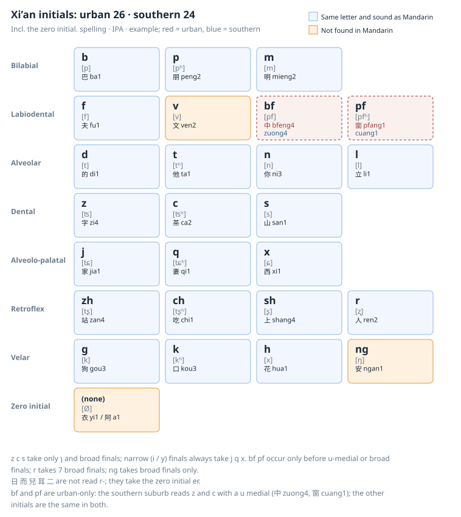
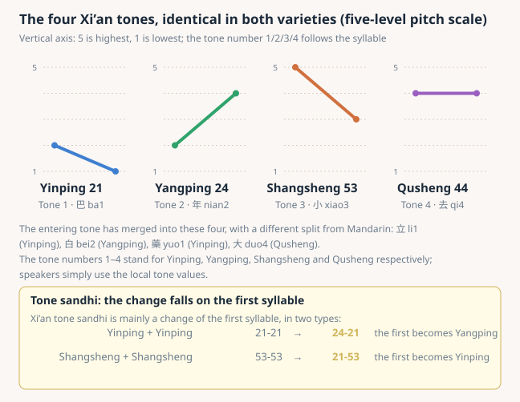
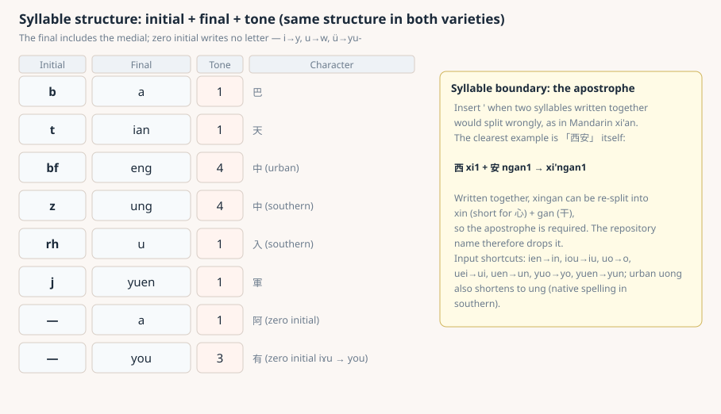

[简体中文](README.md) ｜ [繁體中文](README.zh-Hant.md) ｜ **English** ｜ [日本語](README.ja.md)

# Xi'an Dialect Pronunciation Lookup · xinganhua-ziyencaxin

> Look up how any Chinese character is pronounced in both the **urban** and **southern-suburb** varieties of the Xi'an dialect (Guanzhong Mandarin), complete with Xi'an pinyin, IPA, tone values, and original dictionary glosses. The interface supports Simplified Chinese, Traditional Chinese, English, and Japanese.

- **Live site**: <https://siqyin.github.io/xinganhua-ziyencaxin/>
- **Coverage**: 3,346 urban characters (3,649 readings) · 4,065 southern-suburb characters (4,596 readings, including 720 additions)
- **Languages**: 简体中文 · 繁體中文 · English · 日本語
- **Palette**: ink black `#000000` (Qin) · paper white `#FFFFFF` · crimson `#9F363A` (Han)
- **Font**: self-hosted LXGW WenKai subset (OFL), no external font CDN

---

## Contents

1. [The Xi'an pinyin scheme](#s1)
2. [Site design](#s2)
3. [Lookup rules](#s3)
4. [Reading the result cards](#s4)
5. [Phonology pop-up](#s5)
6. [Sources](#s6)
7. [Colours and font subset](#s7)
8. [Directory layout](#s8)
9. [Local preview](#s9)
10. [Rebuilding data](#s10)
11. [Deployment](#s11)
12. [Data notes and next steps](#s12)
13. [References and credits](#s13)
14. [License](#s14)

---

<a id="s1"></a>

## 1. The Xi'an pinyin scheme

All entries are transcribed in **Xi'an pinyin**, maintaining parallel tables for urban and southern-suburb Xi'an. Each syllable takes the form `initial + final + tone digit` (e.g. `ba1` 巴, `jyuen1` 軍; 中 is `bfeng4` in the urban city and `zung4` in the southern suburb):

- **Initials**: 24 shared (including the zero initial), plus `bf`, `pf` in urban Xi'an (26 total) and `rh` in the southern suburb (25 total): `b p m bf pf f v` / `d t n l` / `g k h ng` / `j q x` / `zh ch sh r` / `z c s rh` (`n` is realised as `[ȵ]` before `i`/`y` finals).
- **Finals**: 39 in urban Xi'an (14 open / 10 `i`-medial / 9 `u`-medial / 6 `ü`-medial, including `uu`, `iae`, and `uong`), and 37 in the southern suburb (13 / 9 / 9 / 6; no `uu`/`iae`, spelling `uong` directly as `ung`).
- **Tones**: Yinping 31, Yangping 24, Shangsheng 53, Qusheng 55; historical entering-tone syllables have merged into these four classes.
- **Formatting & apostrophe**: Tone digits attach directly with no space (`bfeng4`, `jyuen1`); `'` separates ambiguous syllable boundaries (`xi'ngan1` 西安).
- **Short mode & reverse lookup**: Supports single-syllable lookup including shortcuts (`in / iu / o / ui / un` after a consonant, `o` for `yuo` after `j q x`, `yo` for zero-initial or `n`+`yuo`, `yun` for `yuen`; for `uong → ung`, urban Xi'an pinyin can be simplified this way, whereas `ung` is already the original spelling in the southern suburb). The header toggle switches between full and short display without changing IPA.

The six diagrams below are shared with the input-method repository [xinganhua-fuvufa](https://github.com/SiqYin/xinganhua-fuvufa):






**Tone sandhi**: Disyllabic sandhi changes the first syllable in two cases: two Yinping syllables (`31-31`) become `24-31`, and two Shangsheng syllables (`53-53`) become `31-53`.




**Southern-suburb variants**: Before `u`-series finals, southern `z`, `c`, `s`, `rh` also have retroflex variants `zh`, `ch`, `sh`, `r`, and `sh+u` has an `f` variant. These appear on characters whose urban reading starts with `bf`, `pf`, `f`, or `v` and on reviewed Weinan-only entries (e.g. 水 `suei3` with variants `shuei3`, `fei3`), marked with a “variant” badge on each card.

### Urban vs. southern suburb

- **Urban**: Traditional speech inside the walled city.
- **Southern suburb**: Yanta corridor speech (Gaoxin, Xiaozhai, Qujiang), following the **Weinan** sibilant pattern with 25 initials (`rh`, no `bf`/`pf`) and 37 finals (no `uu`/`iae`; `ung` in place of `uong`).

| Item | Urban | Southern suburb |
|---|---|---|
| Initials | 26 (incl. `bf`, `pf`) | 25 (incl. `rh`, no `bf`, `pf`) |
| Finals | 39 (`uu`, `iae`, `uong`) | 37 (no `uu`/`iae`; `ung`) |
| `rh` | 入 `vu1`, 若 `vuo1` | `rhu1`, `rhuo1` |
| Zhī-series closed | 豬 `bfu1`, 春 `pfen1` | `zu1`, `cuen1` |
| Shū-series closed | 書 `fu1`, 水 `fei3` | `su1`, `suei3` |
| Yù rhyme, grade 1 | 都 `du1`, 粗 `cu1` | `dou1`, `cou1` |
| `uong` vs. `ung` | `uong [uɤŋ]` (東 `duong1`, 翁 `wong1`) | `ung [uŋ]` (東 `dung1`, 翁 `wung1`) |
| Tones | 31 / 24 / 53 / 55 | same as urban |

Full distribution rules and comparisons with Mandarin pinyin are documented in [xinganhua-fuvufa](https://github.com/SiqYin/xinganhua-fuvufa) ([简体](https://github.com/SiqYin/xinganhua-fuvufa/blob/main/README.md) / [繁體](https://github.com/SiqYin/xinganhua-fuvufa/blob/main/README.zh-Hant.md) / [English](https://github.com/SiqYin/xinganhua-fuvufa/blob/main/README.en.md) / [日本語](https://github.com/SiqYin/xinganhua-fuvufa/blob/main/README.ja.md)).

---

<a id="s2"></a>

## 2. Site design

This is a self-contained static web page with no backend server. It loads static JSON files and a self-hosted font subset directly in the browser, showing urban and southern-suburb readings side by side. Below the search area, a brief "Accents of Xi'an" panel illustrates the directional layout of Xi'an-type and Weinan-type accents around the Ming city wall as a schematic overview rather than administrative borders.

---

<a id="s3"></a>

## 3. Lookup rules

| Feature | Behaviour |
|---|---|
| Simplified & traditional | Simplified queries expand via OpenCC to traditional dictionary headwords (`鹅`→`鵝`, `边`→`邊`); traditional matches directly |
| Query limit & deduplication | Up to 30 characters per query; duplicates collapse into one card; whitespace and punctuation are stripped |
| Pinyin reverse lookup | Entering a single syllable (with optional tone 1–4, full or any short form) searches both urban and southern tables |
| Mixed input | Mixing Chinese characters and Latin letters prompts you to query them separately |
| Missing characters | Unlisted characters render an explicit "not found" card |
| Shareable URLs | Queries update `?q=…` in the address bar |

---

<a id="s4"></a>

## 4. Reading the result cards

Each card displays the traditional glyph and its simplified counterpart on the left, followed by two columns — **Urban** (crimson) and **Southern** (blue):

| Field | Content | Example |
|---|---|---|
| Pinyin | Full or abbreviated spelling + tone digit | `bfeng4` / `zung4` |
| IPA | IPA + superscript pitch contour | `[pfəŋ⁵⁵]` / `[tsuŋ⁵⁵]` |
| Tone | Tone class + pitch contour | Qusheng 55 |
| Gloss | Source `{}` notes, `白读／文读`, or `variant` badges | Note 白读, 西~, 北~ |

Tone table:

| Digit | 1 | 2 | 3 | 4 |
|---|---|---|---|---|
| Class | Yinping | Yangping | Shangsheng | Qusheng |
| Contour | 31 | 24 | 53 | 55 |
| Example | `tian1` 天 | `nian2` 年 | `xiao3` 小 | `qi4` 去 |

Multiple readings sort by tone class (Yinping → Yangping → Shangsheng → Qusheng), e.g. `着`: `zhao1` / `zhe1` / `bfuo2` / `pfuo2` / `zhao2`.

---

<a id="s5"></a>

## 5. Phonology pop-up

Clicking the "Xi'an phonology & input scheme" bar opens a modal (`Esc` or backdrop click to close) presenting:

- Initials arranged in the 7 canonical rows (`7 / 4 / 4 / 3 / 4 / 4 / 1`), marking urban-only `bf`/`pf`, southern-only `rh`, and `[ȵ]` palatalization of `n` before `i`/`y`.
- Finals grouped by medial (`14 / 10 / 9 / 6`), noting `uu`/`iae` as urban-only and pairing `uong [uɤŋ]` (`duong1`) with `ung [uŋ]` (`dung1`).
- Four tones (`31 / 24 / 53 / 55`) and tone sandhi (`31-31→24-31`, `53-53→31-53`).
- Urban vs. southern comparisons, southern variants, Mandarin pinyin contrasts, input abbreviations, and source links.

---

<a id="s6"></a>

## 6. Sources

Urban readings come from MCPDict's Xi'an table; southern-suburb readings were established character by character with reference to Xi'an, Weinan, Lintong, and Huaxian sound data and offered for reference only.

- [Xi'an table](https://github.com/osfans/MCPDict/blob/master/tools/tables/data/%E8%A5%BF%E5%AE%89.tsv)
- [Weinan table](https://github.com/osfans/MCPDict/blob/master/tools/tables/data/%E6%B8%AD%E5%8D%97.tsv)
- [Lintong table](https://github.com/osfans/MCPDict/blob/master/tools%2Ftables%2Fdata%2F%E4%B8%B4%E6%BD%BC%E6%96%B9%E8%A8%80%E8%AF%AD%E9%9F%B3%E7%A0%94%E7%A9%B6.tsv)
- [Huaxian table](https://github.com/osfans/MCPDict/blob/master/tools%2Ftables%2Fdata%2F%E5%8D%8E%E5%8E%BF.tsv)

---

<a id="s7"></a>

## 7. Colours and font subset

| Colour | Hex | Role |
|---|---|---|
| Ink black | `#000000` | Headwords, body text, footer (Qin) |
| Paper white | `#FFFFFF` | Reading blocks and input field |
| Crimson | `#9F363A` | Seal, primary actions, accents, tone superscripts (Han) |

Background surfaces use warm paper (`#F4EEE9`) and pale card (`#FBF7F4`), with slate blue (`#2F5D8C`) distinguishing the southern column. Typography relies on a subset of [LXGW WenKai](https://github.com/lxgw/LxgwWenKai) (OFL) compiled into `fonts/lxgw-wenkai.woff2`.

---

<a id="s8"></a>

## 8. Directory layout

```
index.html                    single-page app (styles, lookup, reverse lookup, modal)
README.zh-Hant.md             Traditional Chinese README (OpenCC output)
README.en.md / README.ja.md   English and Japanese READMEs
data/source.tsv               urban source table (char / pinyin / IPA[tone] / notes)
data/xian.json                urban lookup JSON
data/nanjiao.json             southern-suburb lookup JSON
data/variants.json            OpenCC s2t / t2s character map
data/i18n.json                UI text packs and phonology tables (4 languages)
figures/                      24 SVG diagrams (6 × 4 languages)
fonts/lxgw-wenkai.woff2       LXGW WenKai font subset
fonts/OFL.txt                 font licence
tools/build_data.py           source.tsv → xian.json / variants.json
tools/build_nanjiao_json.py   南郊音字表.tsv → nanjiao.json
tools/build_i18n.py           i18n.src.json → i18n.json
tools/i18n.src.json           source strings (hans / en / ja)
tools/make_font.py            WOFF2 font subsetter
.github/workflows/static.yml  GitHub Pages deployment workflow
```

---

<a id="s9"></a>

## 9. Local preview

Serve the directory over HTTP so `fetch()` can load JSON files:

```sh
python -m http.server 8765
# open http://127.0.0.1:8765/
```

---

<a id="s10"></a>

## 10. Rebuilding data

```sh
python tools/build_data.py
python tools/build_nanjiao_json.py
python tools/build_i18n.py
python tools/make_font.py
```

`make_font.py` accepts a TTF path argument or `LXGW_TTF` environment variable; rerun it whenever UI copy, IPA characters, or dictionaries change.

---

<a id="s11"></a>

## 11. Deployment

Pushes to `main` trigger `.github/workflows/static.yml`, publishing `index.html`, `data/*.json`, and `fonts/` to GitHub Pages.

---

<a id="s12"></a>

## 12. Data notes and next steps

- Headwords retain MCPDict's traditional forms alongside simplified equivalents.
- Southern readings apply the established dialect constraints (no `bf`/`pf`, no `uu`/`iae`, `rh` for urban `v`, plus retroflex and `f` variants; reviewed exceptions: `癌 ngae2`, `涯 ya2`, `後 hou4`, `芍 shuo2`).
- Three characterless syllables (`zou2`, `tae3`, `sao2`) remain excluded from the lookup index.
- Planned enhancements: query by tone, reverse lookup by IPA, and paginated browsing.

---

<a id="s13"></a>

## 13. References and credits

- [Xi'an](https://github.com/osfans/MCPDict/blob/master/tools/tables/data/%E8%A5%BF%E5%AE%89.tsv), [Weinan](https://github.com/osfans/MCPDict/blob/master/tools/tables/data/%E6%B8%AD%E5%8D%97.tsv), [Lintong](https://github.com/osfans/MCPDict/blob/master/tools%2Ftables%2Fdata%2F%E4%B8%B4%E6%BD%BC%E6%96%B9%E8%A8%80%E8%AF%AD%E9%9F%B3%E7%A0%94%E7%A9%B6.tsv), and [Huaxian](https://github.com/osfans/MCPDict/blob/master/tools%2Ftables%2Fdata%2F%E5%8D%8E%E5%8E%BF.tsv) tables from [osfans/MCPDict](https://github.com/osfans/MCPDict).
- **Southern-suburb sound data**: compiled from those four tables alongside Zhihu discussions on suburban sibilant mergers and checked character by character against the author's family speech — offered **for reference only**.
- [xinganhua-fuvufa](https://github.com/SiqYin/xinganhua-fuvufa) for the Xi'an pinyin scheme, conversion scripts, and diagrams.
- [OpenCC](https://github.com/BYVoid/OpenCC) for simplified/traditional tables; [LXGW WenKai](https://github.com/lxgw/LxgwWenKai) for typography; [wugniu_zyinzozin](https://github.com/SiqYin/wugniu_zyinzozin) for UI layout inspiration.

---

<a id="s14"></a>

## 14. License

The site source and build scripts may be used, modified, and redistributed freely. Underlying character readings and fonts follow MCPDict and LXGW WenKai licensing terms.
