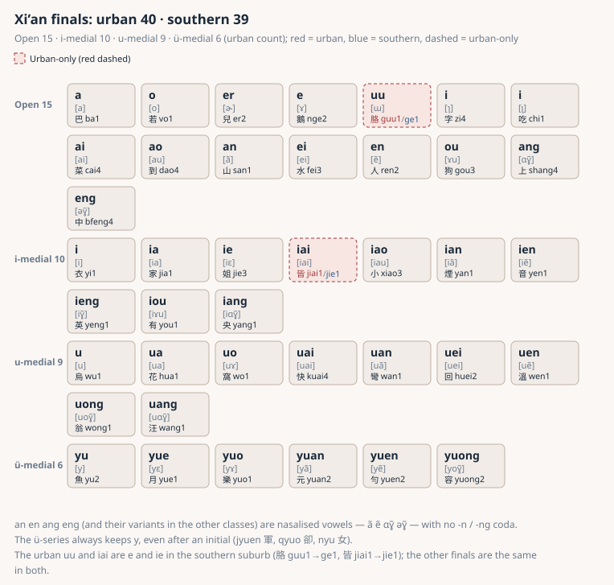
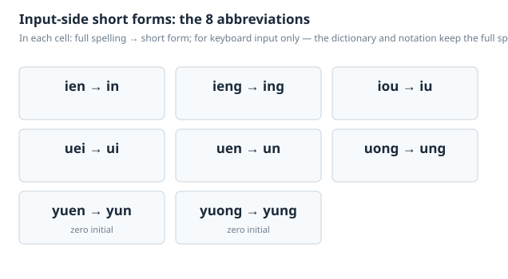
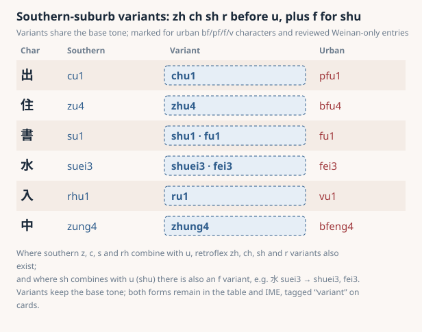

[简体中文](README.md) ｜ [繁體中文](README.zh-Hant.md) ｜ **English** ｜ [日本語](README.ja.md)

# Xi'an Dialect Pronunciation Lookup · xinganhua-ziyencaxin

> Type Chinese characters (simplified or traditional, up to 30 at a time) and see both readings the Xi'an dialect has for them — **urban** and **southern suburb**: **Xi'an pinyin**, **IPA**, **tone**, and the dictionary's own notes. The interface comes in Simplified Chinese, Traditional Chinese, English and Japanese, chosen automatically from your system language and region.

- **Live site**: <https://siqyin.github.io/xinganhua-ziyencaxin/>
- **Character table**: urban 3,345 characters / 3,648 urban readings · 4,594 southern readings (4,065 southern characters, incl. 720 southern-only)
- **Languages**: 简体中文 · 繁體中文 · English · 日本語 (automatic + manual)
- **Colours**: black `#000000` (Qin) · white `#FFFFFF` · crimson `#9F363A` (Han)
- **Font**: a subset of LXGW WenKai, self-hosted, no CDN

---

## Contents

1. [The Xi'an pinyin scheme](#s1)
2. [What this site is](#s2)
3. [Query rules](#s3)
4. [How to read a result](#s4)
5. [The phonology pop-up](#s5)
6. [Where the data comes from](#s6)
7. [Colours and font](#s7)
8. [Directory layout](#s8)
9. [Local preview](#s9)
10. [Rebuilding](#s10)
11. [Deployment](#s11)
12. [Data notes and TODO](#s12)
13. [Data and credits](#s13)
14. [License](#s14)

---

<a id="s1"></a>

## 1. The Xi'an pinyin scheme

Every reading on this site is written in **Xi'an pinyin**, one set each for the urban and the southern-suburb accent. A syllable is initial + final + tone digit, e.g. `ba1` 巴, `jyuen1` 軍; `bfeng4` 中 is the urban reading, the southern one is `zuong4`:

- **Initials**: 24 shared (including the zero initial), plus `bf`, `pf` in the urban variety (26 in all) and `rh` in the southern variety (25 in all): `b p m f v bf pf d t n l z c s rh j q x zh ch sh r g k h ng`
- **Finals**: 38 shared (15 open / 8 i-medial / 9 u-medial / 6 ü-medial), plus `uu`, `iai` in the urban variety — 40 in all (16 / 9 / 9 / 6)
- **Four tones**: Yinping 21, Yangping 24, Shangsheng 53, Qusheng 44; the entering tone has merged into these four
- **The tone digit follows the syllable** with no space: `bfeng4` 中, `jyuen1` 軍
- **Syllable boundaries use an apostrophe**: `xi'ngan1` 西安 (otherwise it would split into xin 心 + gan 干)
- **Abbreviations (input side only)**: `in / ing / iu / ui / un / ung / yun / yung` stand for `ien / ieng / iou / uei / uen / uong / yuen / yuong` (the zero initial only allows `yuen`, `yuong`); the tone digit is not typed.
- **Pinyin reverse lookup**: type one syllable (full or abbreviated spelling, with or without the tone digit) to find the characters read that way; the page has a **full/short display switch** — in the short mode the cards show abbreviated spellings (the IPA stays unchanged).

The six figures below cover the whole scheme. They are the same figures used in the input-method repository [xinganhua-fuvufa](https://github.com/SiqYin/xinganhua-fuvufa), one set per language, identical in content:





Xi'an tone sandhi is mainly a change of the first syllable, in two types: when two consecutive syllables are both Tone 1 (Yinping) 21-21, the first Tone 1 syllable changes to Tone 2 (Yangping), giving 24-21; when two consecutive syllables are both Tone 3 (Shangsheng) 53-53, the first Tone 3 syllable changes to Tone 1 (Yinping), giving 21-53.






**Southern-suburb variants**：Where the southern-suburb initials z, c, s and rh combine with u, the retroflex zh, ch, sh and r are also possible; and where sh combines with u (shu) there is in addition an f variant. These variants are noted only for characters whose urban reading has bf, pf, f or v — for example 水 is `suei3` in the southern suburb, with the variants `shuei3` and `fei3`. A variant keeps the tone of the base reading, gets its own row in the table and is marked “variant”.


### Urban and southern-suburb varieties

Xi'an speech is not uniform, and the site carries two sets of readings:

- **Urban (城区音)**: the variety of the city centre.
- **Southern suburb (南郊音)**: the variety of the southern suburbs (Gaoxin, Xiaozhai, Qujiang). Its retroflex/dental sibilant distribution follows the **Weinan** pattern: 25 initials (`rh`, no `bf`, `pf`) and 38 finals (no `uu`, `iai`); the tones are the same four.

| Item | Urban | Southern suburb |
|---|---|---|
| Initials | 26 (incl. `bf`, `pf`) | 25 (incl. `rh`, no `bf`, `pf`) |
| Finals | 40 (incl. `uu`, `iai`) | 38 (no `uu`, `iai`) |
| rh | 入 `vu1`, 若 `vo1` | `rhu1`, `rhuo1` |
| Zhī-series closed | 豬 `bfu1`, 春 `pfen1` | `zu1`, `cuen1` |
| Shū-series closed | 書 `fu1`, 水 `fei3` | `su1`, `suei3` |
| Yù rhyme, grade 1 | 都 `du1`, 粗 `cu1` | `dou1`, `cou1` |
| Tones | 21 / 24 / 53 / 44 | same as urban |

Of 3,345 characters, 2,971 read identically in both varieties and 374 differ; every result card lists the two sets side by side.

For the full description — distribution rules for initials and finals, orthographic details, a point-by-point comparison with Mandarin pinyin, and the allowed short spellings — see the input-method repository's [README](https://github.com/SiqYin/xinganhua-fuvufa) ([简体](https://github.com/SiqYin/xinganhua-fuvufa/blob/main/README.md) / [繁體](https://github.com/SiqYin/xinganhua-fuvufa/blob/main/README.zh-Hant.md) / [English](https://github.com/SiqYin/xinganhua-fuvufa/blob/main/README.en.md) / [日本語](https://github.com/SiqYin/xinganhua-fuvufa/blob/main/README.ja.md)).

---

<a id="s2"></a>

## 2. What this site is

A self-contained static page: no backend, no database, no requests beyond its own JSON and fonts. It lays out **all** the readings a character has in the Xi'an dialect.
Below the search area there is a short section, “Accents of Xi'an”, with a schematic map: the walled city sits at the centre, with the eastern, western, southern and northern suburbs around it. The city, the northern and the western suburbs belong to the Xi'an type; the southern and eastern suburbs to the Weinan type. The boundary runs north from the eastern edge of the city wall and, on the south-west, follows a diagonal from the wall's south-west corner. The map is a schematic of direction only, not an administrative boundary.

The layout has five layers, all built from black, white and crimson: warm paper background → pale card → white reading block → crimson accents (seal, buttons, tone digits, notes) → ink-black footer.

---

<a id="s3"></a>

## 3. Query rules

| Rule | Behaviour |
|---|---|
| Simplified / traditional | Simplified input is first folded to the dictionary's traditional headword (`鹅`→`鵝`, `边`→`邊`); traditional input matches directly |
| Length | Up to 30 characters at a time; beyond that the page reports the actual count and shows nothing |
| Duplicates | Repeated characters are looked up once; mixed simplified/traditional input (e.g. 「鹅着軍」) expands each |
| Non-Chinese | Letters, digits and symbols are filtered out; if nothing is left, the page says so (no pinyin reverse lookup here) |
| Not in the table | A character missing from the dictionary gets a "not found" card instead of silently disappearing |
| Sharing | The query is written to the address bar as `?q=…`, so the link reproduces the result |

---

<a id="s4"></a>

## 4. How to read a result

One card per character: the large glyph and its simplified form on the left, and two columns on the right — **urban** and **southern suburb** — each listing its own readings. The columns may differ in length, since the southern variety often merges readings.

| Position | Content | Example |
|---|---|---|
| Pinyin | full spelling + tone digit (urban crimson, southern blue) | `bfeng4` ／ `zuong4` |
| IPA | IPA with the tone value as a superscript, one per reading (urban in red, southern in blue) | `[pfəɣ̃⁴⁴]` / `[ʦuoɣ̃⁴⁴]` |
| Tone | tone name + value (English UI: Yinping / Yangping / Shangsheng / Qusheng; Japanese UI: 陰平 / 陽平 / 上声 / 去声) | 去声 44 |
| Note | the `{}` gloss carried by the source table; `白讀／文讀` marked separately | 释 白读, 西~, 北~ |

Tone digits:

| Digit | 1 | 2 | 3 | 4 |
|---|---|---|---|---|
| Name | Yinping | Yangping | Shangsheng | Qusheng |
| Value | 21 | 24 | 53 | 44 |
| Example | `tian1` 天 | `nian2` 年 | `xiao3` 小 | `qu4` 去 |

Polyphonic characters are ordered Yinping → Yangping → Shangsheng → Qusheng; `着`, for instance, has five readings: `zhao1` / `zhe1` / `bfuo2` / `pfuo2` / `zhao2`.

---

<a id="s5"></a>

## 5. The phonology pop-up

The "Xi'an phonology & the input scheme" strip below the search area opens a pop-up (close with Esc or a click on the backdrop). Its content comes from the input-method repository's README:

- the 27 initial cells (24 shared + urban-only `bf`, `pf` + southern-only `rh`, dashed boxes)
- the 40 final cells, grouped by the four classes (open, i-medial, u-medial, ü-medial), with `uu` and `iai` marked urban-only
- the four tones and their values (the same in both varieties)
- **urban vs southern suburb**: the number of initials and finals, `rh`, the `bf`/`pf` and `uu`/`iai` correspondences, and the other regular differences
- **differences from Mandarin pinyin**: identical initials, the nasalised finals, the urban-only initials and finals (the south adds `rh`), characters whose initial does not match, and same digit position with different pitch
- the pop-up text follows the UI language (Simplified / Traditional / English / Japanese)

---

<a id="s6"></a>

## 6. Where the data comes from

The urban Xi'an readings come from the Xi'an sound-data table that records the urban variety; the southern-suburb readings are established character by character with reference to the Xi'an, Weinan, Lintong and Huaxian sound data. Corrections are most welcome.

- [Xi'an sound data](https://github.com/osfans/MCPDict/blob/master/tools/tables/data/%E8%A5%BF%E5%AE%89.tsv)
- [Weinan sound data](https://github.com/osfans/MCPDict/blob/master/tools/tables/data/%E6%B8%AD%E5%8D%97.tsv)
- [Lintong sound data](https://github.com/osfans/MCPDict/blob/master/tools%2Ftables%2Fdata%2F%E4%B8%B4%E6%BD%BC%E6%96%B9%E8%A8%80%E8%AF%AD%E9%9F%B3%E7%A0%94%E7%A9%B6.tsv)
- [Huaxian sound data](https://github.com/osfans/MCPDict/blob/master/tools%2Ftables%2Fdata%2F%E5%8D%8E%E5%8E%BF.tsv)

---

<a id="s7"></a>

## 7. Colours and font

| Colour | Value | Use |
|---|---|---|
| Black | `#000000` | body text, glyphs, footer background — the Qin colour |
| White | `#FFFFFF` | cards and reading blocks, input box — the "paper" of the three |
| Crimson | `#9F363A` | seal, buttons, card edge, footer emphasis, tone digits, IPA superscript, note rule — the Han colour |

Two neutral layers sit between black and white (warm paper `#F4EEE9` for the page, pale card `#FBF7F4`); they add no extra hue.

The font is a subset of [LXGW WenKai](https://github.com/lxgw/LxgwWenKai) (LXGW WenKai Regular, OFL): `fonts/lxgw-wenkai.woff2`, containing only the glyphs the page actually uses (characters, notes, pinyin, IPA and the four UI languages — about 4,900 glyphs / 1.2 MB). See `fonts/OFL.txt` for the licence.

---

<a id="s8"></a>

## 8. Directory layout

```
index.html                    single page: styles, lookup logic, i18n and the pop-up
README.zh-Hant.md             Traditional Chinese README (OpenCC output)
README.en.md / README.ja.md   English and Japanese READMEs
data/source.tsv               source table: character / pinyin / IPA[tone] / notes
data/xian.json                front-end data: character → urban readings
data/nanjiao.json             front-end data: character → southern-suburb readings
data/variants.json            simplified↔traditional maps: s2t, t2s (for the secondary glyph)
data/i18n.json                four text packs + phonology tables (hans / hant / en / ja)
figures/                      scheme figures: four diagrams × four languages (same set as the input repo)
fonts/lxgw-wenkai.woff2       LXGW WenKai subset
fonts/OFL.txt                 font licence
tools/build_data.py           source table → JSON (downloads OpenCC tables if missing)
tools/build_nanjiao_json.py   southern-suburb table → data/nanjiao.json
tools/build_i18n.py           Simplified text → Traditional (OpenCC) + English + Japanese
tools/i18n.src.json           source text packs (hans / en / ja; Traditional is generated)
tools/make_font.py            font subsetting (WOFF2)
.github/workflows/static.yml  publish to GitHub Pages on push to main
```

---

<a id="s9"></a>

## 9. Local preview

The page reads JSON with `fetch`, so double-clicking the HTML will fail. Serve it:

```sh
python -m http.server 8765
# open http://127.0.0.1:8765/
```

---

<a id="s10"></a>

## 10. Rebuilding

```sh
python tools/build_data.py          # data/xian.json, data/variants.json
python tools/build_nanjiao_json.py  # data/nanjiao.json (southern suburb)
python tools/build_i18n.py          # data/i18n.json (Traditional via OpenCC)
python tools/make_font.py           # font subset
```

`make_font.py` reads `D:\Wu\NetDisk Download\lxgw-wenkai-v1.530\lxgw-wenkai-v1.530\LXGWWenKai-Regular.ttf` by default; pass a path or set `LXGW_TTF`:

```sh
python tools/make_font.py /path/to/LXGWWenKai-Regular.ttf
```

After changing text in `index.html`, anything in `data/*.json`, or the data itself, rerun `make_font.py`; otherwise new glyphs (especially kana and Japanese-specific kanji) fall back to system fonts.

---

<a id="s11"></a>

## 11. Deployment

Pushing to `main` triggers GitHub Actions (Settings → Pages → Source: GitHub Actions). The workflow copies `index.html`, `data/xian.json`, `data/nanjiao.json`, `data/variants.json`, `data/i18n.json`, `fonts/*.woff2` and the OFL into `_site`; the source table and build scripts are not published.

---

<a id="s12"></a>

## 12. Data notes and TODO

- Glyphs are traditional (as in the MCPDict source), with the simplified form shown alongside on each card for comparison
- The southern readings are folded from the southern-suburb adjudication sheet (2026-11-20) plus the shared readings, under the same constraints — no `bf`/`pf` (urban-only), no `uu`/`iai` (urban-only), plus `rh` (urban v): `bf→z`, `pf→c` (the final gains a u medial), `uu→e`, `iai→ie`. A few characters are overridden by review: 癌 `ngai2` only, 涯 `ya2`, 後 `hou4` only, 芍 `shuo2`
- Three syllables in the source have a sound but no character (`zou2`, `tai3`, `sao2`) and are not searchable
- If a reading disagrees with your own dialect, `data/source.tsv` is the authority; edit it and rerun the build
- TODO: reverse lookup by IPA, query by tone, paginated browsing of the character table (pinyin reverse lookup and the full/short display switch are live)

---

<a id="s13"></a>

## 13. Data and credits

- [Xi'an table](https://github.com/osfans/MCPDict/blob/master/tools/tables/data/%E8%A5%BF%E5%AE%89.tsv), [Weinan table](https://github.com/osfans/MCPDict/blob/master/tools/tables/data/%E6%B8%AD%E5%8D%97.tsv), [Lintong table](https://github.com/osfans/MCPDict/blob/master/tools%2Ftables%2Fdata%2F%E4%B8%B4%E6%BD%BC%E6%96%B9%E8%A8%80%E8%AF%AD%E9%9F%B3%E7%A0%94%E7%A9%B6.tsv), [Huaxian table](https://github.com/osfans/MCPDict/blob/master/tools%2Ftables%2Fdata%2F%E5%8D%8E%E5%8E%BF.tsv) — all from [osfans/MCPDict](https://github.com/osfans/MCPDict); the Xi'an table is the source of the urban readings (IPA), while the Weinan, Lintong and Huaxian tables served as references for compiling the southern-suburb data
- **The southern-suburb sound data** has no ready-made table of its own: it was compiled on the basis of the Xi'an, Weinan, Lintong and Huaxian tables, with reference to Zhihu discussions on how the flat and retroflex sibilants merge in the southern- and eastern-suburb accents, and checked character by character against the speech of the author and their family — it is therefore **for reference only**
- [xinganhua-fuvufa](https://github.com/SiqYin/xinganhua-fuvufa) — the Xi'an pinyin scheme, transliteration script, phonology notes and the four-language figures
- [OpenCC](https://github.com/BYVoid/OpenCC) — simplified/traditional tables
- [LXGW WenKai](https://github.com/lxgw/LxgwWenKai) — CJK font (OFL)
- [wugniu_zyinzozin](https://github.com/SiqYin/wugniu_zyinzozin) — reference for the site's approach, language detection and pop-up layout

---

<a id="s14"></a>

## 14. License

The page and build scripts may be used, modified and redistributed freely. The reading data comes from MCPDict and the font from LXGW WenKai; follow their respective terms.

---

## Note

The Simplified Chinese version is the source; the Traditional version is converted from it with OpenCC, and the English and Japanese versions are translations. All four are meant to be identical; if they diverge, the Simplified version wins. This document was written and translated with AI assistance.
