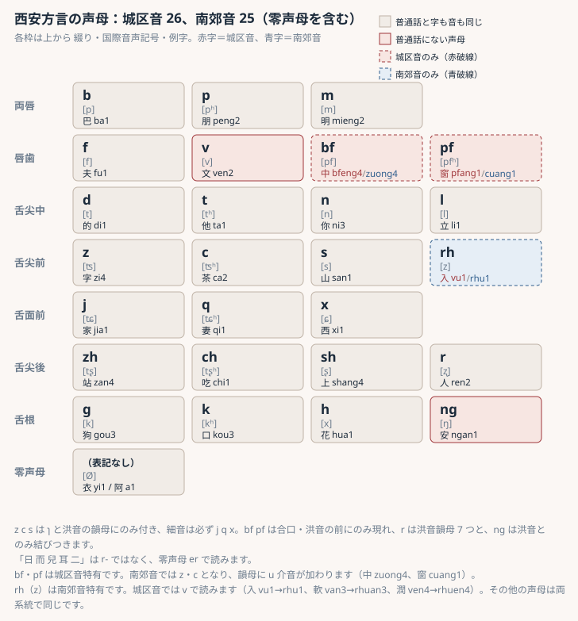
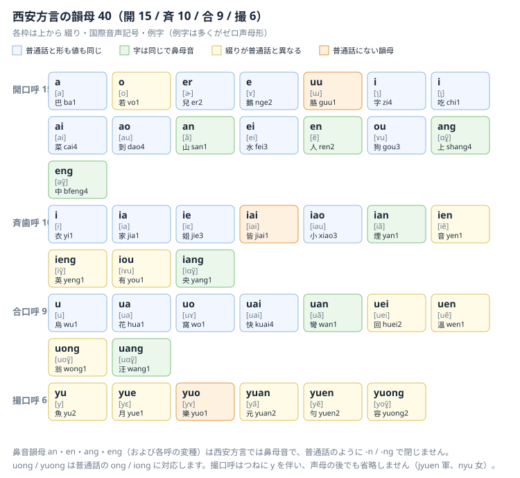
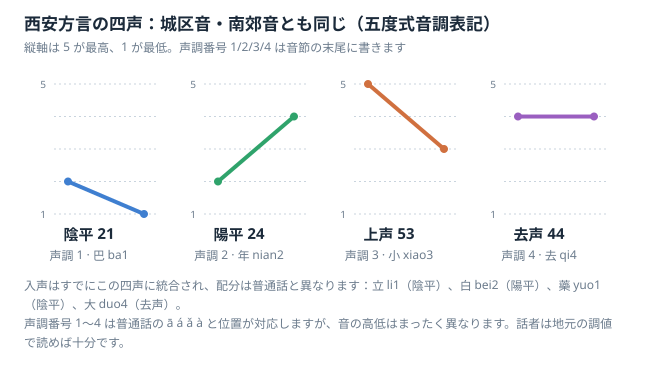
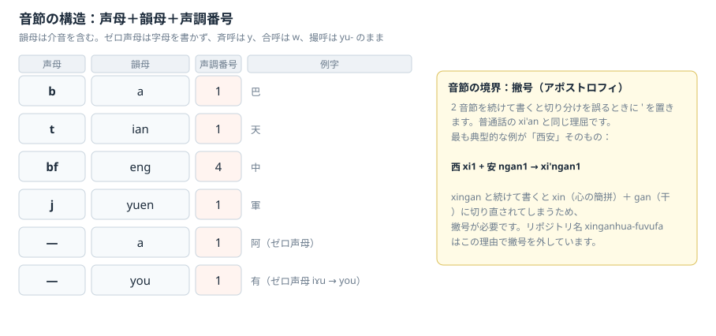
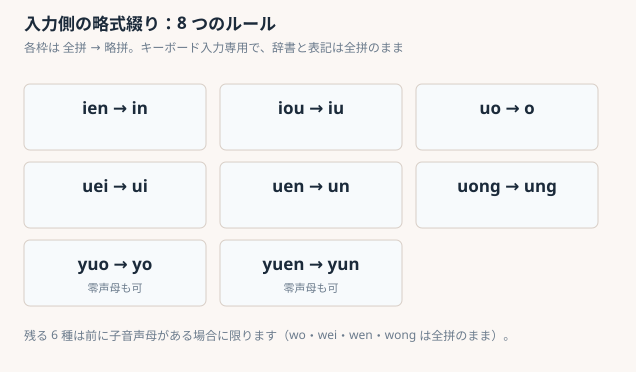
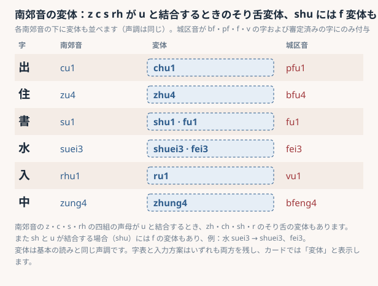

[简体中文](README.md) ｜ [繁體中文](README.zh-Hant.md) ｜ [English](README.en.md) ｜ **日本語**

# 西安方言 字音検索 · xinganhua-ziyencaxin

> 漢字を入力して西安方言の**城区音**と**南郊音**を並べて確認できる静的検索サイトです。西安方言ピンイン・国際音声記号（IPA）・声調・原表注記を一覧でき、UI は簡体字・繁体字・英語・日本語の四言語に対応しています。

- **公開 URL**：<https://siqyin.github.io/xinganhua-ziyencaxin/>
- **収録規模**：城区見出し字 3,346（3,649 件）・南郊見出し字 4,065（4,596 件、増補 720 字を含む）
- **対応言語**：簡体中文 · 繁體中文 · English · 日本語
- **配色**：黒 `#000000`（秦）・白 `#FFFFFF`・絳紅 `#9F363A`（漢）
- **フォント**：霞鹜文楷サブセット（OFL）を自前配信（CDN 不使用）

---

## 目次

1. [西安方言ピンイン方案](#s1)
2. [サイトの構成](#s2)
3. [検索と逆引きの規則](#s3)
4. [結果カードの見方](#s4)
5. [音韻ポップアップ](#s5)
6. [資料の出典](#s6)
7. [配色とフォント](#s7)
8. [ディレクトリ構成](#s8)
9. [ローカル確認](#s9)
10. [データの再生成](#s10)
11. [公開手順](#s11)
12. [収録方針と今後の予定](#s12)
13. [参照と謝辞](#s13)
14. [ライセンス](#s14)

---

<a id="s1"></a>

## 1. 西安方言ピンイン方案

サイト上のすべての読みは**西安方言ピンイン**で表記し、城区音と南郊音を対等に収録しています。1 音節は「声母＋韻母＋声調番号」で書き、`ba1`（巴）・`jyuen1`（軍）のように記します（「中」は城区音 `bfeng4`、南郊音 `zung4`）：

- **声母**：共通 24（零声母を含む）に加え、城区音は `bf`・`pf` を含め 26、南郊音は `rh` を含め 25 です。並び順は `b p m bf pf f v` / `d t n l` / `g k h ng` / `j q x` / `zh ch sh r` / `z c s rh`（`n` は `i`・`y` の細音の前で `[ȵ]` となります）。
- **韻母**：城区音は 39（開 14・斉 10・合 9・撮 6、`uu`・`iae`・`uong` を含む）、南郊音は 37（開 13・斉 9・合 9・撮 6、`uu`・`iae` がなく、合口鼻尾韻を本来通り `ung` と表記）です。
- **四声**：陰平 31・陽平 24・上声 53・去声 55（旧入声は四声に合流）。
- **表記と区切り**：調号は空白なしで音節末に続け（`bfeng4`・`jyuen1`）、誤分割を防ぐ境界には `'` を入れます（`xi'ngan1` 西安）。
- **簡拼と表示切替**：検索欄での単音節ピンイン逆引きは簡拼（子音後の `in / iu / o / ui / un`、`j q x` の後の `yuo` は `o`、零声母と `n` の後は `yo`、`yuen` は `yun`；`uong → ung` は城区音ではこのように簡略化でき、南郊音は本来の綴りそのものが `ung`）にも対応し、画面上部のスイッチで全拼／簡拼に切り替えられます（IPA は不変）。

以下の六枚の図版は入力方案リポジトリ [xinganhua-fuvufa](https://github.com/SiqYin/xinganhua-fuvufa) と共通です：







**連続変調**：二音節が続く場合は前字が変化し、陰平＋陰平（`31-31`）は `24-31`（前字が陽平）、上声＋上声（`53-53`）は `31-53`（前字が陰平）になります。







**南郊音の変体**：南郊音で `z`・`c`・`s`・`rh` が `u` と結合する際、そり舌の `zh`・`ch`・`sh`・`r` 変体があり、`sh+u` には `f` 変体もあります。城区音が `bf`・`pf`・`f`・`v` の字と審定済み渭南独自字に付与され（例：水 `suei3` → `shuei3`・`fei3`）、カード上では「変体」タグで示します。

### 城区音と南郊音の対比

- **城区音**：従来の城内中心部の話しことば。
- **南郊音**：高新・小寨・曲江など南郊の口音。平舌音・そり舌音の分布は**渭南型**に近く、声母 25（`rh` あり、`bf`・`pf` なし）・韻母 37（`uu`・`iae` なし、`ung` 表記）です。

| 項目 | 城区音 | 南郊音 |
|---|---|---|
| 声母 | 26（`bf`・`pf` あり） | 25（`rh` あり、`bf`・`pf` なし） |
| 韻母 | 39（`uu`・`iae`・`uong` あり） | 37（`uu`・`iae` なし、`ung` 表記） |
| `rh` | 入 `vu1`・若 `vuo1` | `rhu1`・`rhuo1` |
| 知系合口 | 豬 `bfu1`・春 `pfen1` | `zu1`・`cuen1` |
| 書母合口 | 書 `fu1`・水 `fei3` | `su1`・`suei3` |
| 遇摂一等 | 都 `du1`・粗 `cu1` | `dou1`・`cou1` |
| `uong` と `ung` | `uong [uɤŋ]`（東 `duong1`・翁 `wong1`） | `ung [uŋ]`（東 `dung1`・翁 `wung1`） |
| 声調 | 陰平 31・陽平 24・上声 53・去声 55 | 同じ |

音韻規則の詳細は [xinganhua-fuvufa](https://github.com/SiqYin/xinganhua-fuvufa)（[简体](https://github.com/SiqYin/xinganhua-fuvufa/blob/main/README.md) ／ [繁體](https://github.com/SiqYin/xinganhua-fuvufa/blob/main/README.zh-Hant.md) ／ [English](https://github.com/SiqYin/xinganhua-fuvufa/blob/main/README.en.md) ／ [日本語](https://github.com/SiqYin/xinganhua-fuvufa/blob/main/README.ja.md)）をご覧ください。

---

<a id="s2"></a>

## 2. サイトの構成

サーバーや外部 DB を持たない単一ページ構成で、同梱の JSON とフォントのみを読み込んで城区音・南郊音を並べて表示します。検索欄の下には「西安市内のアクセント分布」として、明代城壁を囲む四郊における西安型と渭南型の位置関係を示す模式図を添えています。

---

<a id="s3"></a>

## 3. 検索と逆引きの規則

| 機能 | 挙動 |
|---|---|
| 簡体・繁体対応 | 簡体字は OpenCC 変換により辞書の繁体字頭へ展開（`鹅`→`鵝`、`边`→`邊`）、繁体字は直接検索 |
| 文字数上限・重複整理 | 一度に 30 字まで。重複文字は 1 枚にまとめ、空白や句読点は自動除去 |
| ピンイン逆引き | 1 音節（調号 1〜4 任意）の入力で全拼・簡拼から城区音・南郊音の両字表を逆引き |
| 混在入力 | 漢字と英字の混在時は分けて検索するよう案内 |
| 未収録字 | 字表にない字も無言で省かず、未収録カードを表示 |
| URL 共有 | 検索語を `?q=…` に反映し、URL 共有で同じ結果を再現可能 |

---

<a id="s4"></a>

## 4. 結果カードの見方

左側に大字の繁体字形と簡体字形を置き、右側に**城区音**（赤系）と**南郊音**（青系）を二列で表示します：

| 欄 | 内容 | 例 |
|---|---|---|
| ピンイン | 全拼（または簡拼）＋調号 | `bfeng4` ／ `zung4` |
| IPA | 国際音声記号＋調値上付き | `[pfəŋ⁵⁵]` ／ `[tsuŋ⁵⁵]` |
| 声調 | 調名＋調値（UI 言語に追随） | 去声 55 |
| 注記 | 原表 `{}` 注釈、`白讀／文讀`、`変体` タグ | 注 白读, 西~, 北~ |

声調対応表：

| 番号 | 1 | 2 | 3 | 4 |
|---|---|---|---|---|
| 調名 | 陰平 | 陽平 | 上声 | 去声 |
| 調値 | 31 | 24 | 53 | 55 |
| 例字 | `tian1` 天 | `nian2` 年 | `xiao3` 小 | `qi4` 去 |

多音字は陰平 → 陽平 → 上声 → 去声の順に並びます（例：`着` `zhao1` / `zhe1` / `bfuo2` / `pfuo2` / `zhao2`）。

---

<a id="s5"></a>

## 5. 音韻ポップアップ

検索欄下の「西安方言の音韻と入力方案」バーを押すとモーダルが開き（`Esc` または背景クリックで閉じる）、以下の表を確認できます：

- 声母表：調音位置に沿った 7 行配列（`7 / 4 / 4 / 3 / 4 / 4 / 1`）、城区特有の `bf`/`pf`、南郊特有の `rh`、細音前 `n→[ȵ]` の注記。
- 韻母表：四呼（`14 / 10 / 9 / 6`）の行列配列、`uu`/`iae` の城区専用表示、および `uong / ung` の `duong1 [uɤŋ]`・`dung1 [uŋ]` 併記。
- 四声（`31 / 24 / 53 / 55`）と連続変調（`31-31→24-31`・`53-53→31-53`）。
- 城区音・南郊音対照表、変体解説、普通話ピンイン比較、簡拼一覧、出典リンク。

---

<a id="s6"></a>

## 6. 資料の出典

城区音は MCPDict の西安話データ表に依拠し、南郊音は西安話・渭南話・臨潼話・華県話などの資料をもとに一字ずつ整理した参考データです。

- [西安話データ表](https://github.com/osfans/MCPDict/blob/master/tools/tables/data/%E8%A5%BF%E5%AE%89.tsv)
- [渭南話データ表](https://github.com/osfans/MCPDict/blob/master/tools/tables/data/%E6%B8%AD%E5%8D%97.tsv)
- [臨潼話データ表](https://github.com/osfans/MCPDict/blob/master/tools%2Ftables%2Fdata%2F%E4%B8%B4%E6%BD%BC%E6%96%B9%E8%A8%80%E8%AF%AD%E9%9F%B3%E7%A0%94%E7%A9%B6.tsv)
- [華県話データ表](https://github.com/osfans/MCPDict/blob/master/tools%2Ftables%2Fdata%2F%E5%8D%8E%E5%8E%BF.tsv)

---

<a id="s7"></a>

## 7. 配色とフォント

| 色 | 値 | 用途 |
|---|---|---|
| 墨黒 | `#000000` | 見出し字・本文・フッター（秦） |
| 白 | `#FFFFFF` | 読みカード・入力欄 |
| 絳紅 | `#9F363A` | 印章・主ボタン・枠線・調号・IPA 上付き（漢） |

背景に暖かみのある紙色 `#F4EEE9` と `#FBF7F4` を用い、南郊音列には藍 `#2F5D8C` を配しています。フォントは [霞鹜文楷](https://github.com/lxgw/LxgwWenKai)（OFL）を必要字形のみでサブセット化した `fonts/lxgw-wenkai.woff2` を使用しています。

---

<a id="s8"></a>

## 8. ディレクトリ構成

```
index.html                    単一ページ本体
README.zh-Hant.md             繁体字版 README（OpenCC 生成）
README.en.md / README.ja.md   英語・日本語版 README
data/source.tsv               城区音原表
data/xian.json                城区音検索用 JSON
data/nanjiao.json             南郊音検索用 JSON
data/variants.json            簡繁対照マップ（s2t / t2s）
data/i18n.json                四言語 UI テキスト＆音韻表データ
figures/                      音韻図版 24 枚（6 種 × 4 言語）
fonts/lxgw-wenkai.woff2       霞鹜文楷サブセット
fonts/OFL.txt                 フォントライセンス
tools/build_data.py           source.tsv → xian.json / variants.json
tools/build_nanjiao_json.py   南郊音字表.tsv → nanjiao.json
tools/build_i18n.py           i18n.src.json → i18n.json
tools/i18n.src.json           簡・英・日テキスト原稿
tools/make_font.py            WOFF2 サブセット生成
.github/workflows/static.yml  GitHub Pages 公開ワークフロー
```

---

<a id="s9"></a>

## 9. ローカル確認

JSON の `fetch()` に HTTP サーバーが必要なため、リポジトリ直下で簡易サーバーを起動して確認します：

```sh
python -m http.server 8765
# http://127.0.0.1:8765/ を開く
```

---

<a id="s10"></a>

## 10. データの再生成

```sh
python tools/build_data.py
python tools/build_nanjiao_json.py
python tools/build_i18n.py
python tools/make_font.py
```

`make_font.py` は引数または環境変数 `LXGW_TTF` で元フォントを指定できます。UI 文言・IPA・字表を更新した際は再実行してください。

---

<a id="s11"></a>

## 11. 公開手順

`main` ブランチへのプッシュで `.github/workflows/static.yml` が起動し、`index.html`・`data/*.json`・`fonts/` が GitHub Pages へ配信されます。

---

<a id="s12"></a>

## 12. 収録方針と今後の予定

- 見出し字は MCPDict 原本の繁体字を保ちつつ、カード上に簡体字を併記しています。
- 南郊音は裁定表および共通音から構築し、`bf`/`pf` なし・`uu`/`iae` なし・`rh` 追加、および審定済み変体を反映しています（例外校訂：`癌 ngae2`・`涯 ya2`・`後 hou4`・`芍 shuo2`）。
- 原表で文字欠如（`□`）の 3 音節（`zou2`・`tae3`・`sao2`）は検索対象から除いています。
- 今後、声調フィルタ・IPA 逆引き・字表一覧ブラウズの追加を予定しています。

---

<a id="s13"></a>

## 13. 参照と謝辞

- [西安話](https://github.com/osfans/MCPDict/blob/master/tools/tables/data/%E8%A5%BF%E5%AE%89.tsv)・[渭南話](https://github.com/osfans/MCPDict/blob/master/tools/tables/data/%E6%B8%AD%E5%8D%97.tsv)・[臨潼話](https://github.com/osfans/MCPDict/blob/master/tools%2Ftables%2Fdata%2F%E4%B8%B4%E6%BD%BC%E6%96%B9%E8%A8%80%E8%AF%AD%E9%9F%B3%E7%A0%94%E7%A9%B6.tsv)・[華県話](https://github.com/osfans/MCPDict/blob/master/tools%2Ftables%2Fdata%2F%E5%8D%8E%E5%8E%BF.tsv) の各データ表（[osfans/MCPDict](https://github.com/osfans/MCPDict)）。
- **南郊話の資料**：既成字表がないため上記四表を下敷きに知乎上の議論を参照し、筆者および家族の発音で一字ずつ照合した**参考資料**です。
- [xinganhua-fuvufa](https://github.com/SiqYin/xinganhua-fuvufa) —— 西安方言ピンイン方案本体と図版データ。
- [OpenCC](https://github.com/BYVoid/OpenCC)（簡繁変換表）・[霞鹜文楷](https://github.com/lxgw/LxgwWenKai)（フォント）・[wugniu_zyinzozin](https://github.com/SiqYin/wugniu_zyinzozin)（画面設計の参照）。

---

<a id="s14"></a>

## 14. ライセンス

ページ本体とスクリプトは自由に使用・改変・再配布できます。字音データとフォントの著作権・利用許諾はそれぞれ MCPDict と霞鹜文楷に従います。
