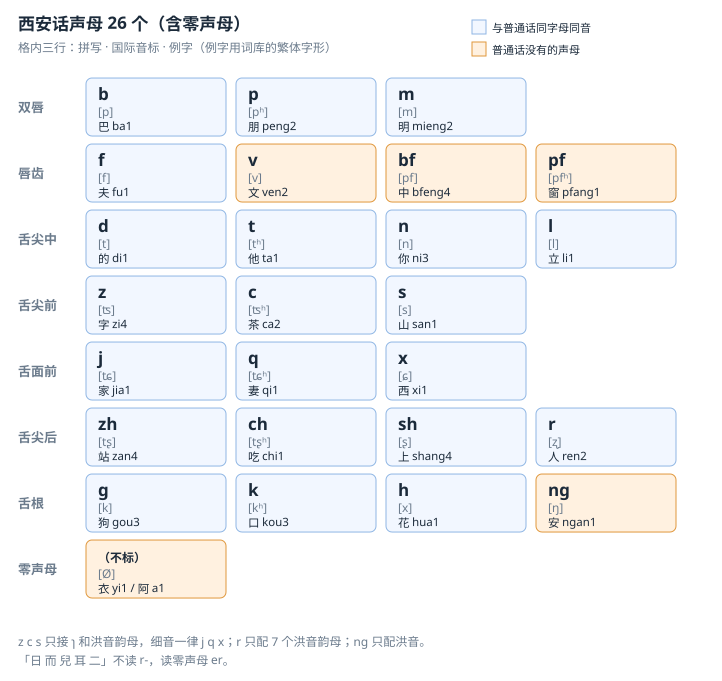
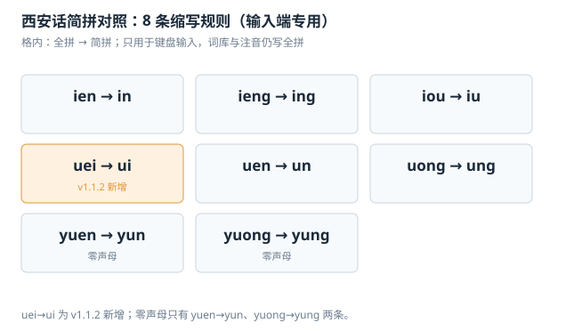

**简体中文** ｜ [繁體中文](README.zh-Hant.md) ｜ [English](README.en.md) ｜ [日本語](README.ja.md)

# 西安话字音查询 · xinganhua-ziyencaxin

> 输入汉字（简繁皆可，一次最多 30 字），查它在西安话里的两套读法——**城区音**与**南郊音**：**西安话拼音**、**国际音标**、**声调**，以及词典原有的释注。界面有简、繁、英、日四种语言，并按系统语言与接入地区自动判定。

- **线上地址**：<https://siqyin.github.io/xinganhua-ziyencaxin/>
- **字表**：城区字头 3,345 ／ 城区音 3,648 条 · 南郊音 4,350 条（南郊字头 4,065，含渭南独有等新增 720 字）
- **语言**：简体中文 · 繁體中文 · English · 日本語（自动判定 + 手选）
- **配色**：黑 `#000000`（秦）· 白 `#FFFFFF` · 绛红 `#9F363A`（汉）
- **字体**：霞鹜文楷子集，自托管，不依赖 CDN

---

## 目录

1. [西安话拼音方案](#s1)
2. [这个网站是什么](#s2)
3. [查询规则](#s3)
4. [结果怎么读](#s4)
5. [音系与输入方案浮窗](#s5)
6. [数据从哪来](#s6)
7. [配色与字体](#s7)
8. [目录结构](#s8)
9. [本地预览](#s9)
10. [重新构建](#s10)
11. [部署](#s11)
12. [数据说明与待办](#s12)
13. [数据与致谢](#s13)
14. [授权](#s14)

---

<a id="s1"></a>

## 一、西安话拼音方案

本站的每一个读音都用**西安话拼音**标注，城区音、南郊音各一套。一个音节写成「声母 + 韵母 + 调号」，例如 `ba1` 巴、`jyuen1` 軍；`bfeng4` 中是城区音，南郊音作 `zuong4`：

- **声母**：两套共用 24 个（含零声母），城区音另有 `bf`、`pf`（共 26），南郊音另有 `rh`（共 25）：`b p m f v bf pf d t n l z c s rh j q x zh ch sh r g k h ng`
- **韵母**：两套共用 38 个（开 15 ／ 齐 8 ／ 合 9 ／ 撮 6），城区音另有 `uu`、`iai`，共 40 个（开 16 ／ 齐 9 ／ 合 9 ／ 撮 6）
- **四声**：阴平 21、阳平 24、上声 53、去声 44；入声已并入四调
- **调号紧贴音节**，不空格：`bfeng4` 中、`jyuen1` 軍
- **音节边界用撇号**：`xi'ngan1` 西安（否则会被切成 xin 心 + gan 干）
- **简拼**：输入端兼容 `in / ing / iu / ui / un / ung / yun / yung`（分别对应 `ien / ieng / iou / uei / uen / uong / yuen / yuong`；零声母只放行 `yuen`、`yuong`）；调号不输入。
- **拼音反查**：输入一个音节（全拼或简拼，带不带调号都行）即可反查读它的字；界面上有**全拼／简拼显示开关**，切到简拼后卡片上的注音就用简拼写法（音标不变）。

下面五张图把方案讲全（与输入法仓库 [xinganhua-fuvufa](https://github.com/SiqYin/xinganhua-fuvufa) 用的是同一套图，各语言版本内容一致）：




西安话的连读变调主要是前字变调，分为两类：连续两字为一声（阴平）21-21 时，第一个一声字改读二声（阳平）24-21；连续两字为三声（上声）53-53 时，第一个三声字改读一声（阴平）21-53。




### 城区音与南郊音

西安话内部不止一种口音，本站同时收两套：

- **城区音**：西安城区（城内）的口音。
- **南郊音**：西安南郊（高新、小寨、曲江一带）的口音。平翘舌分布属**渭南型**：声母 25 个（多 `rh`，没有 `bf`、`pf`），韵母 38 个（没有 `uu`、`iai`），声调仍是四声。

| 项 | 城区音 | 南郊音 |
|---|---|---|
| 声母 | 26（含 `bf`、`pf`） | 25（含 `rh`，无 `bf`、`pf`） |
| 韵母 | 40（含 `uu`、`iai`） | 38（无 `uu`、`iai`） |
| rh | 入 `vu1`、若 `vo1` | `rhu1`、`rhuo1` |
| 知系合口 | 豬 `bfu1`、春 `pfen1` | `zu1`、`cuen1` |
| 书母合口 | 書 `fu1`、水 `fei3` | `su1`、`suei3` |
| 遇摄一等 | 都 `du1`、粗 `cu1` | `dou1`、`cou1` |
| 声调 | 阴平 21、阳平 24、上声 53、去声 44 | 同城区音 |

3,345 个字里，两套读法完全相同的 2,971 字，有差异的 374 字；查询结果里每个字把两套读音并排列出。

方案的完整说明——声母韵母的分布规则、正字法细则、与普通话拼音的逐条对照、可用的简拼——见输入法仓库的 [README](https://github.com/SiqYin/xinganhua-fuvufa)（[简体](https://github.com/SiqYin/xinganhua-fuvufa/blob/main/README.md) ／ [繁體](https://github.com/SiqYin/xinganhua-fuvufa/blob/main/README.zh-Hant.md) ／ [English](https://github.com/SiqYin/xinganhua-fuvufa/blob/main/README.en.md) ／ [日本語](https://github.com/SiqYin/xinganhua-fuvufa/blob/main/README.ja.md)）。

---

<a id="s2"></a>

## 二、这个网站是什么

一个离线的静态网页：没有后端、没有数据库，除页面自身的 JSON 与字体外不发任何请求，把一个字在西安话里的**所有**读音摊开给你看。
页面下方另有一段「西安市的口音分区」：以明城墙以内的城区为中心，按方位分东、西、南、北四郊；城区与北郊、西郊属西安型，南郊、东郊属渭南型。东北以城墙东缘向北引的直线为界，西南以城墙西南角向西南引的斜线为界。示意图只是方位示意，不是行政边界。

版面分五层，全是黑白绛红三色的不同层次：暖纸页底 → 浅色卡片 → 白色读音块 → 绛红强调（印章、按钮、调号、释注）→ 墨黑页脚。

---

<a id="s3"></a>

## 三、查询规则

| 规则 | 行为 |
|---|---|
| 简繁 | 输入简体先折成字典里的繁体字头再查（`鹅`→`鵝`、`边`→`邊`）；输入繁体直接命中 |
| 字数 | 一次最多 30 个汉字，超出会提示实际字数，不出结果 |
| 去重 | 输入里重复的字只查一次；简繁混输（如「鹅着軍」）各自展开 |
| 非汉字 | 字母、数字、符号会被过滤；全是非汉字时给出提示（本页不做拼音反查） |
| 未收录 | 字表里没有的字会显示一张「未收录」卡片，不会静默消失 |
| 分享 | 查询写入地址栏 `?q=…`，复制链接可复原结果 |

---

<a id="s4"></a>

## 四、结果怎么读

每个字一张卡片：左边是大字与简体形，右边并排两栏——**城区音**与**南郊音**，各自逐条列读音。两栏的条数可能不同（南郊音常把一些又读并掉）。

| 位置 | 内容 | 例 |
|---|---|---|
| 拼音 | 全拼 + 调号（调号用绛红；城区音红、南郊音蓝） | `bfeng4` ／ `zuong4` |
| 音标 | 国际音标 + 调值上标，与左栏拼音一一对应（城区音红、南郊音蓝） | `[pfəɣ̃⁴⁴]` ／ `[ʦuoɣ̃⁴⁴]` |
| 声调 | 调名 + 调值（英文界面显示 Yinping / Yangping / Shangsheng / Qusheng，日文界面显示 陰平 / 陽平 / 上声 / 去声） | 去声 44 |
| 释注 | 字表原带的 `{}` 注释；`白讀／文讀` 单独标出 | 释 白读, 西~, 北~ |

调号对照：

| 调号 | 1 | 2 | 3 | 4 |
|---|---|---|---|---|
| 调名 | 阴平 | 阳平 | 上声 | 去声 |
| 调值 | 21 | 24 | 53 | 44 |
| 例 | `tian1` 天 | `nian2` 年 | `xiao3` 小 | `qu4` 去 |

多音字按阴平 → 阳平 → 上声 → 去声排序，例如 `着` 有五读：`zhao1` / `zhe1` / `bfuo2` / `pfuo2` / `zhao2`。

---

<a id="s5"></a>

## 五、音系与输入方案浮窗

页面下方的「西安话音系与输入方案」是一整块可点的入口，点开是浮窗（Esc 或点遮罩关闭），内容取自输入法仓库的 README：

- 声母 27 格（共用 24 ＋ 城区特有 `bf`、`pf` ＋ 南郊特有 `rh`，虚线框标出）
- 韵母 40 格，按开齐合撮四呼分组，`uu`、`iai` 标为城区音特有
- 四声与调值（两支相同）
- **城区音与南郊音的区别**：声韵母数量、`rh`、`bf`／`pf` 与 `uu`／`iai` 的对应，以及其他成组差异
- **与普通话拼音的异同**：声母完全一样的、鼻化韵母的读法、城区音多出来的声母韵母（南郊音另有 `rh`）、声母对不上的字、调号同位不同调值
- 浮窗内的文案随界面语言切换（简 / 繁 / 英 / 日）

---

<a id="s6"></a>

## 六、数据从哪来

西安话城区音来源于记录城区音的西安话音档；南郊音参考西安话、渭南话、临潼话、华县话等音档逐字厘定，如有错谬，敬请批评指正。

- [西安话音档](https://github.com/osfans/MCPDict/blob/master/tools/tables/data/%E8%A5%BF%E5%AE%89.tsv)
- [渭南话音档](https://github.com/osfans/MCPDict/blob/master/tools/tables/data/%E6%B8%AD%E5%8D%97.tsv)
- [临潼话音档](https://github.com/osfans/MCPDict/blob/master/tools%2Ftables%2Fdata%2F%E4%B8%B4%E6%BD%BC%E6%96%B9%E8%A8%80%E8%AF%AD%E9%9F%B3%E7%A0%94%E7%A9%B6.tsv)
- [华县话音档](https://github.com/osfans/MCPDict/blob/master/tools%2Ftables%2Fdata%2F%E5%8D%8E%E5%8E%BF.tsv)

---

<a id="s7"></a>

## 七、配色与字体

| 颜色 | 值 | 用途 |
|---|---|---|
| 黑 | `#000000` | 正文、字头、页脚底；秦色 |
| 白 | `#FFFFFF` | 卡片与读音块、输入框；三色之中的「纸」 |
| 绛红 | `#9F363A` | 印章、按钮、卡片左边、页脚强调、调号、音标上标、释注边线；汉色 |

底色还有两层中性层次（暖纸 `#F4EEE9` 页底、浅卡 `#FBF7F4`），是黑白之间的过渡，不另立色相。

字体是 [霞鹜文楷](https://github.com/lxgw/LxgwWenKai)（LXGW WenKai Regular，OFL 授权）的子集：`fonts/lxgw-wenkai.woff2`，只含页面实际用到的字形（字头、释注、拼音、音标与四语界面文案，约 4,900 字形 / 1.2 MB）。字体授权见 `fonts/OFL.txt`。

---

<a id="s8"></a>

## 八、目录结构

```
index.html                    单页：样式、查询逻辑、i18n 与浮窗都在这一个文件里
README.zh-Hant.md             繁体说明（OpenCC 转出）
README.en.md / README.ja.md   英文、日文说明
data/source.tsv               字音源表：字 / 拼音 / IPA[调名] / 释注
data/xian.json                前端数据：字头 → 城区音读音数组
data/nanjiao.json             前端数据：字头 → 南郊音读音数组
data/variants.json            简繁映射：s2t（简→繁）、t2s（繁→简，用于并列显示）
data/i18n.json                四语文案 + 音系表数据（简 / 繁 / 英 / 日）
figures/                      西安话拼音方案配图：五张图 × 四种语言（与输入法仓库同一套）
fonts/lxgw-wenkai.woff2       霞鹜文楷子集
fonts/OFL.txt                 字体授权
tools/build_data.py           源表 → JSON（OpenCC 表缺失时自动下载）
tools/build_nanjiao_json.py   南郊音字表 → data/nanjiao.json
tools/build_i18n.py           简体文案 → 繁体（OpenCC）+ 英、日，输出 i18n.json
tools/i18n.src.json           四语文案的源文件（简 / 英 / 日，繁体由脚本生成）
tools/make_font.py            字体子集化（WOFF2）
.github/workflows/static.yml  推到 main 时自动发布 GitHub Pages
```

---

<a id="s9"></a>

## 九、本地预览

页面用 `fetch` 读 JSON，直接双击 HTML 会失败，起个静态服务器即可：

```sh
python -m http.server 8765
# 打开 http://127.0.0.1:8765/
```

---

<a id="s10"></a>

## 十、重新构建

```sh
python tools/build_data.py          # 生成 data/xian.json、data/variants.json
python tools/build_nanjiao_json.py  # 生成 data/nanjiao.json（南郊音）
python tools/build_i18n.py          # 生成 data/i18n.json（繁体由 OpenCC 转出）
python tools/make_font.py           # 重新生成字体子集
```

`make_font.py` 默认读 `D:\Wu\NetDisk Download\lxgw-wenkai-v1.530\lxgw-wenkai-v1.530\LXGWWenKai-Regular.ttf`，也可以用参数或环境变量 `LXGW_TTF` 指定：

```sh
python tools/make_font.py /path/to/LXGWWenKai-Regular.ttf
```

改了 `index.html` 里的文案、`data/*.json` 或数据后都要重跑 `make_font.py`，否则新字（尤其是日文假名与新字体汉字）会落回系统字体。

---

<a id="s11"></a>

## 十一、部署

推到 `main` 后由 GitHub Actions 发布（仓库 Settings → Pages → Source 选 GitHub Actions）。工作流把 `index.html`、`data/xian.json`、`data/nanjiao.json`、`data/variants.json`、`data/i18n.json`、`fonts/*.woff2` 与 OFL 拷进 `_site`，源表与构建脚本不随站点发布。

---

<a id="s12"></a>

## 十二、数据说明与待办

- 用字是繁体（MCPDict 原表如此），卡片上并列显示简体形，便于对照
- 南郊音按西安南郊音逐字裁定表（2026-11-20）与两地一致读音折出，硬约束是「没有 `bf`／`pf`（城区特有）、没有 `uu`／`iai`（城区特有）」，另有 `rh`（城区读 v）；`bf→z`、`pf→c`（韵母增生 u 介音），`uu→e`，`iai→ie`。个别字按核定覆盖：癌只读 `ngai2`、涯读 `ya2`、後只读 `hou4`、芍读 `shuo2`
- 原表有 3 个只有音、没有字的音节（`zou2`、`tai3`、`sao2`），不进查询
- 拼音与音标若与你的方言有出入，以 `data/source.tsv` 为准，改完重跑构建脚本即可
- 待办：音标反查、按声调查询、字表分页浏览（拼音反查与全拼／简拼显示已上线）

---

<a id="s13"></a>

## 十三、数据与致谢

- [西安话音档](https://github.com/osfans/MCPDict/blob/master/tools/tables/data/%E8%A5%BF%E5%AE%89.tsv)、[渭南话音档](https://github.com/osfans/MCPDict/blob/master/tools/tables/data/%E6%B8%AD%E5%8D%97.tsv)、[临潼话音档](https://github.com/osfans/MCPDict/blob/master/tools%2Ftables%2Fdata%2F%E4%B8%B4%E6%BD%BC%E6%96%B9%E8%A8%80%E8%AF%AD%E9%9F%B3%E7%A0%94%E7%A9%B6.tsv)、[华县话音档](https://github.com/osfans/MCPDict/blob/master/tools%2Ftables%2Fdata%2F%E5%8D%8E%E5%8E%BF.tsv)——均出自 [osfans/MCPDict](https://github.com/osfans/MCPDict)；西安话音档即城区音字音数据源（国际音标），渭南、临潼、华县三档用于南郊音的整理参照
- **南郊话音档**没有现成字表可依：以西安话、渭南话、临潼话、华县话音档等为基底，参照知乎上关于南郊音、东郊音平翘舌归并情况的讨论，并与本人及家人的口音逐字校对整理而成，因此**仅供参考**
- [xinganhua-fuvufa](https://github.com/SiqYin/xinganhua-fuvufa) —— 西安话拼音方案、转写脚本、音系说明与四语配图
- [OpenCC](https://github.com/BYVoid/OpenCC) —— 简繁对照表
- [霞鹜文楷](https://github.com/lxgw/LxgwWenKai) —— 中文字体（OFL）
- [wugniu_zyinzozin](https://github.com/SiqYin/wugniu_zyinzozin) —— 站点做法、语言判定与浮窗版面的参照

---

<a id="s14"></a>

## 十四、授权

网页与构建脚本可自由使用、修改、再分发。字音数据来自 MCPDict，字体来自霞鹜文楷，版权与授权请遵循各自项目说明。

---

## 声明

简体版为源文；繁体版由 OpenCC 从简体转出，英文与日文版为对应译本。四版内容一致，如有出入以简体版为准。本文由 AI 辅助撰写与翻译。
