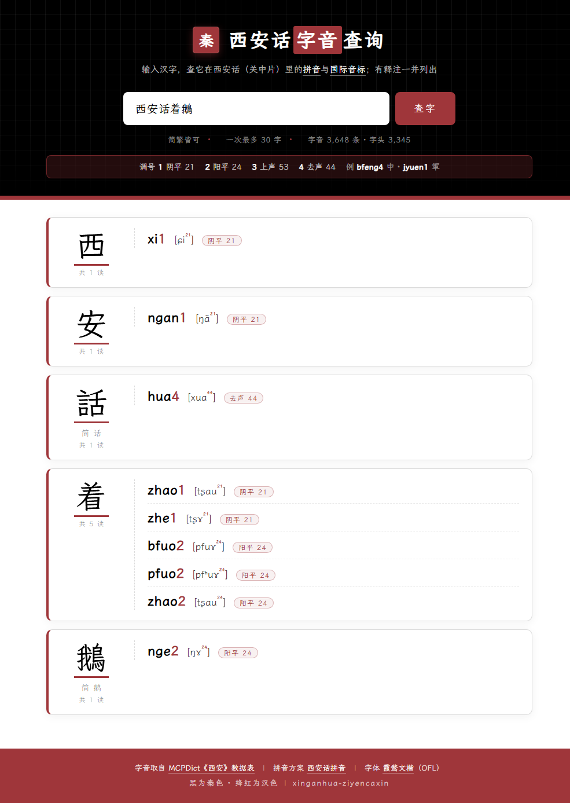

# 西安话字音查询 · xinganhua-ziyencaxin

> 输入汉字（简繁皆可，一次最多 30 字），查它在西安话（关中片）里的全部字音：**西安话拼音**、**国际音标**、**声调**，以及词典原有的释注。



- **线上地址**：<https://siqyin.github.io/xinganhua-ziyencaxin/>
- **字表**：字头 3,345 ／ 字音 3,648 ／ 多音字 275 ／ 带释注 102
- **配色**：黑 `#000000`（秦）· 白 `#FFFFFF` · 绛红 `#9F363A`（汉）
- **字体**：霞鹜文楷子集，自托管，不依赖 CDN

---

## 目录

1. [这个网站是什么](#一这个网站是什么)
2. [查询规则](#二查询规则)
3. [结果怎么读](#三结果怎么读)
4. [数据从哪来](#四数据从哪来)
5. [配色与字体](#五配色与字体)
6. [目录结构](#六目录结构)
7. [本地预览](#七本地预览)
8. [重新构建](#八重新构建)
9. [部署](#九部署)
10. [数据说明与待办](#十数据说明与待办)
11. [数据与致谢](#十一数据与致谢)
12. [授权](#十二授权)

---

## 一、这个网站是什么

一个离线的静态网页：没有后端、没有数据库，除页面自身的 JSON 与字体外不发任何请求，把一个字在西安话里的**所有**读音摊开给你看。

页面只有三种颜色：**黑**是秦色，做首屏；**白**是纸，承载结果；**绛红**是汉色，做印、做分隔、做页脚、做一切强调。三块各有面积，不是一条装饰线。

## 二、查询规则

| 规则 | 行为 |
|---|---|
| 简繁 | 输入简体先折成字典里的繁体字头再查（`鹅`→`鵝`、`边`→`邊`）；输入繁体直接命中 |
| 字数 | 一次最多 30 个汉字，超出会提示实际字数，不出结果 |
| 去重 | 输入里重复的字只查一次；简繁混输（如「鹅着軍」）各自展开 |
| 非汉字 | 字母、数字、符号会被过滤；全是非汉字时给出提示（本页不做拼音反查） |
| 未收录 | 字表里没有的字会显示一张「未收录」卡片，不会静默消失 |
| 分享 | 查询写入地址栏 `?q=…`，复制链接可复原结果 |

## 三、结果怎么读

每个字一张卡片：左边是大字与简体形，右边逐条列读音。

| 位置 | 内容 | 例 |
|---|---|---|
| 拼音 | 全拼 + 调号（调号用绛红） | `bfeng4` |
| 音标 | 国际音标 + 调值上标 | `[pfã⁴⁴]` |
| 声调 | 调名 + 调值 | 去声 44 |
| 释注 | 字表原带的 `{}` 注释；`白讀／文讀` 单独标出 | 释 白读, 西~, 北~ |

调号对照：

| 调号 | 1 | 2 | 3 | 4 |
|---|---|---|---|---|
| 调名 | 阴平 | 阳平 | 上声 | 去声 |
| 调值 | 21 | 24 | 53 | 44 |
| 例 | `tian1` 天 | `nian2` 年 | `xiao3` 小 | `qu4` 去 |

多音字按阴平 → 阳平 → 上声 → 去声排序，例如 `着` 有五读：`zhao1` / `zhe1` / `bfuo2` / `pfuo2` / `zhao2`。

## 四、数据从哪来

```
MCPDict《西安》数据表（国际音标）
        │  tools/ipa2pinyin.mjs（输入法仓库）
        ▼
   字 / 拼音 / IPA / 释注  →  data/source.tsv
        │  tools/build_data.py（+ OpenCC 简繁表）
        ▼
   data/xian.json（字头 → 读音数组）
   data/variants.json（简→繁、繁→简）
```

| 项 | 数 |
|---|---|
| 字头 | 3,345 |
| 字音条目 | 3,648（一字一音一行） |
| 多音字 | 275 |
| 带释注 | 102 |
| 不计调音节 | 392 |

简繁映射用 OpenCC 的 `STCharacters.txt` / `TSCharacters.txt`，构建时按需下载，不随仓库分发。

## 五、配色与字体

| 颜色 | 值 | 用途 |
|---|---|---|
| 黑 | `#000000` | 首屏底、正文、字头；秦色 |
| 白 | `#FFFFFF` | 页面底、输入框、卡片；三色之中的「纸」 |
| 绛红 | `#9F363A` | 印章、按钮、分隔带、页脚、调号、音标上标、释注边线；汉色 |

字体是 [霞鹜文楷](https://github.com/lxgw/LxgwWenKai)（LXGW WenKai Regular，OFL 授权）的子集：`fonts/lxgw-wenkai.woff2`，只含页面实际用到的字形（字头、释注、拼音、音标与界面文案，约 4,700 字形 / 1.2 MB）。字体授权见 `fonts/OFL.txt`。

## 六、目录结构

```
index.html                    单页：样式与查询逻辑都在这一个文件里
screenshot.png                本说明用的界面截图
data/source.tsv               字音源表：字 / 拼音 / IPA[调名] / 释注
data/xian.json                前端数据：字头 → 读音数组
data/variants.json            简繁映射：s2t（简→繁）、t2s（繁→简，用于并列显示）
fonts/lxgw-wenkai.woff2       霞鹜文楷子集
fonts/OFL.txt                 字体授权
tools/build_data.py           源表 → JSON（OpenCC 表缺失时自动下载）
tools/make_font.py            字体子集化（WOFF2）
.github/workflows/static.yml  推到 main 时自动发布 GitHub Pages
```

## 七、本地预览

页面用 `fetch` 读 JSON，直接双击 HTML 会失败，起个静态服务器即可：

```sh
python -m http.server 8765
# 打开 http://127.0.0.1:8765/
```

## 八、重新构建

```sh
python tools/build_data.py          # 生成 data/xian.json、data/variants.json
python tools/make_font.py           # 重新生成字体子集
```

`make_font.py` 默认读 `D:\Wu\NetDisk Download\lxgw-wenkai-v1.530\lxgw-wenkai-v1.530\LXGWWenKai-Regular.ttf`，也可以用参数或环境变量 `LXGW_TTF` 指定：

```sh
python tools/make_font.py /path/to/LXGWWenKai-Regular.ttf
```

改了 `index.html` 里的文案或数据后要重跑 `make_font.py`，否则新字会落回系统字体。改完 `source.tsv` 只要重跑 `build_data.py`。

## 九、部署

推到 `main` 后由 GitHub Actions 发布（仓库 Settings → Pages → Source 选 GitHub Actions）。工作流只把 `index.html`、`data/xian.json`、`data/variants.json`、`fonts/*.woff2` 与 OFL 拷进 `_site`，源表与构建脚本不随站点发布。

## 十、数据说明与待办

- 用字是繁体（MCPDict 原表如此），卡片上并列显示简体形，便于对照
- 原表有 3 个只有音、没有字的音节（`zou2`、`tai3`、`sao2`），不进查询
- 拼音与音标若与你的方言有出入，以 `data/source.tsv` 为准，改完重跑构建脚本即可
- 待办：拼音／音标反查、按声调查询、字表分页浏览

## 十一、数据与致谢

- [osfans/MCPDict](https://github.com/osfans/MCPDict)（`tools/tables/data/西安.tsv`）—— 字音数据源
- [xinganhua-fuvufa](https://github.com/SiqYin/xinganhua-fuvufa) —— 西安话拼音方案与 IPA → 拼音转写脚本
- [OpenCC](https://github.com/BYVoid/OpenCC) —— 简繁对照表
- [霞鹜文楷](https://github.com/lxgw/LxgwWenKai) —— 中文字体（OFL）
- [wugniu_zyinzozin](https://github.com/SiqYin/wugniu_zyinzozin) —— 本页的做法与版面参照

## 十二、授权

网页与构建脚本可自由使用、修改、再分发。字音数据来自 MCPDict，字体来自霞鹜文楷，版权与授权请遵循各自项目说明。

---

## 声明

本 README 的全部内容由 Qoder 平台下的 Qwen 模型撰写输出。
