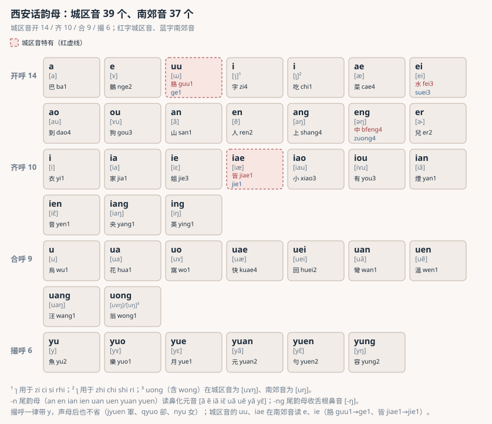
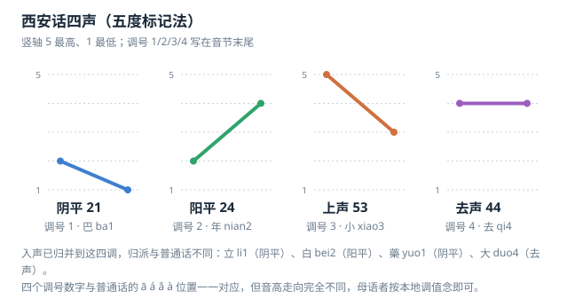
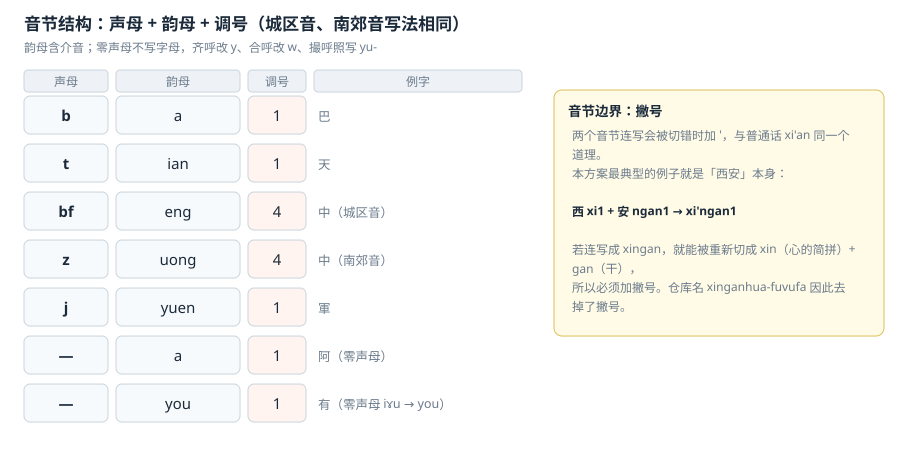
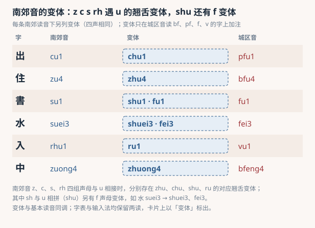

**简体中文** ｜ [繁體中文](README.zh-Hant.md) ｜ [English](README.en.md) ｜ [日本語](README.ja.md)

# 西安话字音查询 · xinganhua-ziyencaxin

> 在线查单字在西安话里的**城区音**与**南郊音**两套读法：西安话拼音、国际音标、四声调值及词典原注一并呈列。界面备有简体中文、繁体中文、English、日本語四版，可随环境自动切换，也可右上角手动点选。

- **线上地址**：<https://siqyin.github.io/xinganhua-ziyencaxin/>
- **字表规模**：城区字头 3,346 ／ 城区音 3,649 条 · 南郊音 4,594 条（南郊字头 4,065，含渭南独有等增补 720 字）
- **界面语言**：简体中文 · 繁體中文 · English · 日本語
- **页面配色**：墨黑 `#000000`（秦）· 素白 `#FFFFFF` · 绛红 `#9F363A`（汉）
- **自托管字体**：霞鹜文楷子集（OFL），不依赖外部字体 CDN

---

## 目录

1. [西安话拼音方案](#s1)
2. [站点结构与分工](#s2)
3. [查字与反查规则](#s3)
4. [读音卡片说明](#s4)
5. [音系浮窗内容](#s5)
6. [字音数据来源](#s6)
7. [色彩与字体子集](#s7)
8. [目录说明](#s8)
9. [本地预览](#s9)
10. [数据重建](#s10)
11. [静态部署](#s11)
12. [字表体例与后续计划](#s12)
13. [参考与致谢](#s13)
14. [授权许可](#s14)

---

<a id="s1"></a>

## 一、西安话拼音方案

全站采用统一的一套**西安话拼音**拼写，城区音与南郊音各有字表。每个音节由「声母 + 韵母 + 调号」组成，例如 `ba1` 巴、`jyuen1` 軍；「中」在城区读 `bfeng4`，南郊读 `zung4`：

- **声母**：共用 24 个（含零声母），城区音另有 `bf`、`pf`（共 26），南郊音另有 `rh`（共 25）。按发音部位排作：`b p m bf pf f v` / `d t n l` / `g k h ng` / `j q x` / `zh ch sh r` / `z c s rh`（`n` 拼 `i`、`y` 细音时音值为 `[ȵ]`）。
- **韵母**：城区音 39 个（开 14 ／ 齐 10 ／ 合 9 ／ 撮 6），南郊音 37 个（开 13 ／ 齐 9 ／ 合 9 ／ 撮 6；无 `uu`、`iae`，合口鼻尾韵直接作 `ung`）。
- **四声**：阴平 31、阳平 24、上声 53、去声 55；古入声已并入四调。
- **标调与隔音**：调号紧跟音节末尾不空格（`bfeng4`、`jyuen1`）；音节连写易误切处用撇号隔开（`xi'ngan1` 西安）。
- **简拼与全简切换**：输入与反查端支持简拼（`in / iu / o / ui / un` 限前有辅音声母，`j q x` 后的 `yuo` 简作 `o`，零声母与 `n` 后简作 `yo`，`yuen` 简作 `yun`；至于 `uong → ung`，城区音中拼音可以这样简化，南郊音本来的拼写就是后者 `ung`）。顶部切换按钮可在「全拼」与「简拼」显示间即时切换（音标保持不变）。

下方六张配图与输入法仓库 [xinganhua-fuvufa](https://github.com/SiqYin/xinganhua-fuvufa) 共用，简繁英日四语内容同步：






**连读变调**：两字相连主要变前字，分两类——连续两个阴平（`31-31`）时前字改读阳平（`24-31`）；连续两个上声（`53-53`）时前字改读阴平（`31-53`）。






**南郊音变体**：南郊音 `z`、`c`、`s`、`rh` 四组声母与 `u` 相接时，另有 `zh`、`ch`、`sh`、`r` 翘舌变体；其中 `sh` 拼 `u` 时另有 `f` 声母变体。变体只加注在城区音读 `bf`、`pf`、`f`、`v` 的字与逐字审定的渭南独有字上（如「水」南郊音 `suei3` 另有变体 `shuei3`、`fei3`），与基本读音同调，结果卡片内以「变体」标签标出。

### 城区音与南郊音对照

- **城区音**：传统西安城内口音。
- **南郊音**：西安南郊（高新、小寨、曲江一带）口音，平翘舌分布属**渭南型**：声母 25 个（多 `rh`，无 `bf`、`pf`），韵母 37 个（无 `uu`、`iae`，合口鼻尾韵作 `ung`），四声调值与城区相同。

| 项 | 城区音 | 南郊音 |
|---|---|---|
| 声母 | 26（含 `bf`、`pf`） | 25（含 `rh`，无 `bf`、`pf`） |
| 韵母 | 39（含 `uu`、`iae`、`uong`） | 37（无 `uu`、`iae`，作 `ung`） |
| `rh` | 入 `vu1`、若 `vuo1` | `rhu1`、`rhuo1` |
| 知系合口 | 豬 `bfu1`、春 `pfen1` | `zu1`、`cuen1` |
| 书母合口 | 書 `fu1`、水 `fei3` | `su1`、`suei3` |
| 遇摄一等 | 都 `du1`、粗 `cu1` | `dou1`、`cou1` |
| `uong / ung` 韵 | `uong [uɤŋ]`（東 `duong1`、翁 `wong1`） | `ung [uŋ]`（東 `dung1`、翁 `wung1`） |
| 声调 | 阴平 31、阳平 24、上声 53、去声 55 | 同城区音 |

完整的声韵母配合规则、正字法与普通话拼音对照，可参阅输入法仓库 [xinganhua-fuvufa](https://github.com/SiqYin/xinganhua-fuvufa)（[简体](https://github.com/SiqYin/xinganhua-fuvufa/blob/main/README.md) ／ [繁體](https://github.com/SiqYin/xinganhua-fuvufa/blob/main/README.zh-Hant.md) ／ [English](https://github.com/SiqYin/xinganhua-fuvufa/blob/main/README.en.md) ／ [日本語](https://github.com/SiqYin/xinganhua-fuvufa/blob/main/README.ja.md)）。

---

<a id="s2"></a>

## 二、站点结构与分工

整站为纯静态单页应用，无后端服务或远程数据库，页面加载后只读取随站部署的 JSON 数据与本地字体子集，一次性把单个汉字在城区与南郊两套口音中的所有读法并排展开。

页面下半部分附有「西安市的口音分区」简介与示意图：以明城墙内城区为中心环列四郊，城区、北郊、西郊大致归西安型，南郊、东郊大致归渭南型；图中两条虚线仅为方位示意，并非行政区划边界。

---

<a id="s3"></a>

## 三、查字与反查规则

| 项 | 规则说明 |
|---|---|
| 简繁自动映射 | 输入简体字先按 OpenCC 映射展开至词典繁体字头（如 `鹅`→`鵝`、`边`→`邊`），输入繁体直接命中 |
| 字数与去重 | 单次最多查 30 个汉字，重复字只渲染一张卡片；中英文标点与空白自动剥离 |
| 拼音反查 | 纯字母（可带调号 1–4）输入按单个西安话音节反查字表，同时兼容全拼与简拼，两套字表合并展示 |
| 混排校验 | 汉字与英文字母混输时提示分开查询 |
| 未收录提示 | 词典未收的字会列出缺字提示卡片，不静默跳过 |
| 链接分享 | 查询词写入 URL `?q=…`，复制链接即可复现结果 |

---

<a id="s4"></a>

## 四、读音卡片说明

每张结果卡片左侧展示繁体字头与对应简体，右侧分栏并排显示**城区音**（红调）与**南郊音**（蓝调）：

| 字段 | 内容 | 示例 |
|---|---|---|
| 拼音 | 全拼（或简拼）+ 调号 | `bfeng4` ／ `zung4` |
| 音标 | 国际音标 + 调值上标 | `[pfəŋ⁵⁵]` ／ `[tsuŋ⁵⁵]` |
| 声调 | 调名 + 调值（随界面语言切换） | 去声 55 |
| 释注 | 原词表所附 `{}` 释义及 `白读／文读`、`变体` 标记 | 释 白读, 西~, 北~ |

调号与调值对照：

| 调号 | 1 | 2 | 3 | 4 |
|---|---|---|---|---|
| 调名 | 阴平 | 阳平 | 上声 | 去声 |
| 调值 | 31 | 24 | 53 | 55 |
| 例字 | `tian1` 天 | `nian2` 年 | `xiao3` 小 | `qi4` 去 |

多音字按阴平、阳平、上声、去声先后排列（如 `着` 收五读：`zhao1` / `zhe1` / `bfuo2` / `pfuo2` / `zhao2`）。

---

<a id="s5"></a>

## 五、音系浮窗内容

点开搜索栏下方的「西安话音系与输入方案」横条可呼出浮窗（按 `Esc` 或点击遮罩关闭），按新音系顺序完整列出：

- 声母表：按六组发音部位及零声母 7 行排布，标出城区音特有 `bf`、`pf` 与南郊音特有 `rh`（含 `n` 逢细音读 `[ȵ]` 注释）。
- 韵母表：按开（14）、齐（10）、合（9）、撮（6）四呼分行排列，`uu`、`iae` 标示城区特有，`uong / ung` 并列城区 `duong1 [uɤŋ]` 与南郊 `dung1 [uŋ]`。
- 四声与连读变调规则（`31 / 24 / 53 / 55` 及 `31-31→24-31`、`53-53→31-53`）。
- 城区音与南郊音对照、南郊音变体说明、与普通话拼音异同、输入端简化拼写及字音来源链接。

---

<a id="s6"></a>

## 六、字音数据来源

西安话城区音直接取自记录城区音的西安话音档；南郊音参考西安话、渭南话、临潼话、华县话等音档逐字厘定，仅供参考，错漏之处欢迎反馈指正。

- [西安话音档](https://github.com/osfans/MCPDict/blob/master/tools/tables/data/%E8%A5%BF%E5%AE%89.tsv)
- [渭南话音档](https://github.com/osfans/MCPDict/blob/master/tools/tables/data/%E6%B8%AD%E5%8D%97.tsv)
- [临潼话音档](https://github.com/osfans/MCPDict/blob/master/tools%2Ftables%2Fdata%2F%E4%B8%B4%E6%BD%BC%E6%96%B9%E8%A8%80%E8%AF%AD%E9%9F%B3%E7%A0%94%E7%A9%B6.tsv)
- [华县话音档](https://github.com/osfans/MCPDict/blob/master/tools%2Ftables%2Fdata%2F%E5%8D%8E%E5%8E%BF.tsv)

---

<a id="s7"></a>

## 七、色彩与字体子集

| 颜色 | 色值 | 角色 |
|---|---|---|
| 墨黑 | `#000000` | 字头、主文、页脚底色（秦） |
| 素白 | `#FFFFFF` | 读音白底块与输入框 |
| 绛红 | `#9F363A` | 印章、主按钮、卡片边线、调号与上标（汉） |

另以暖纸 `#F4EEE9` 与浅卡 `#FBF7F4` 铺底，南郊音分栏采用靛蓝 `#2F5D8C` 区分。字体使用 [霞鹜文楷](https://github.com/lxgw/LxgwWenKai)（OFL），由构建脚本扫描页面、四语 JSON 与全部扩展区字头及国际音标符号子集化为 `fonts/lxgw-wenkai.woff2`。

---

<a id="s8"></a>

## 八、目录说明

```
index.html                    单页主文件（样式、查询、反查与音系浮窗）
README.zh-Hant.md             繁体说明（由 OpenCC 从简体转出）
README.en.md / README.ja.md   英文、日文说明
data/source.tsv               城区音字源表：字 / 拼音 / IPA[调名] / 释注
data/xian.json                城区音前端数据
data/nanjiao.json             南郊音前端数据
data/variants.json            OpenCC 简繁对照映射（s2t / t2s）
data/i18n.json                四语界面文案与音系表数据
figures/                      六张音系配图 × 四种语言（共 24 份）
fonts/lxgw-wenkai.woff2       霞鹜文楷子集字体
fonts/OFL.txt                 字体授权文件
tools/build_data.py           source.tsv → xian.json / variants.json
tools/build_nanjiao_json.py   南郊音字表.tsv → nanjiao.json
tools/build_i18n.py           i18n.src.json → i18n.json（自动生成繁体）
tools/i18n.src.json           简、英、日三语文案源文件
tools/make_font.py            生成 WOFF2 字体子集
.github/workflows/static.yml  GitHub Pages 自动部署流程
```

---

<a id="s9"></a>

## 九、本地预览

因页面通过 `fetch` 加载同源 JSON 数据，请勿直接双击打开 HTML，需在仓库根目录启动本地静态服务器：

```sh
python -m http.server 8765
# 浏览器访问 http://127.0.0.1:8765/
```

---

<a id="s10"></a>

## 十、数据重建

```sh
python tools/build_data.py
python tools/build_nanjiao_json.py
python tools/build_i18n.py
python tools/make_font.py
```

`make_font.py` 默认读取 `D:\Wu\NetDisk Download\lxgw-wenkai-v1.530\lxgw-wenkai-v1.530\LXGWWenKai-Regular.ttf`，也可通过命令行参数或环境变量 `LXGW_TTF` 指定字体路径。每次修改文案、音标符号或字表后，需重跑 `make_font.py` 以免新字符回退到系统字体。

---

<a id="s11"></a>

## 十一、静态部署

代码推送至 `main` 分支后，由 `.github/workflows/static.yml` 将 `index.html`、`data/*.json` 与 `fonts/` 打包发布至 GitHub Pages，源表与构建工具不会进入线上产物。

---

<a id="s12"></a>

## 十二、字表体例与后续计划

- 词典字头保留 MCPDict 原本繁体字形，卡片上同时列出对应简体形。
- 南郊音由逐字裁定表与两地一致读音合成：无 `bf`/`pf`（改读 `z`/`c` 并增 `u` 介音）、无 `uu`/`iae`（并入 `e`/`ie`）、新增 `rh`（对应城区 `v`），并按审定规则补充翘舌与 `f` 变体；特例字如 `癌 ngae2`、`涯 ya2`、`後 hou4`、`芍 shuo2`。
- 源表中 3 个有音无字音节（`zou2`、`tae3`、`sao2`）未收入查询字表。
- 后续计划补入按声调筛选、音标反查与全字表分页浏览。

---

<a id="s13"></a>

## 十三、参考与致谢

- [西安话音档](https://github.com/osfans/MCPDict/blob/master/tools/tables/data/%E8%A5%BF%E5%AE%89.tsv)、[渭南话音档](https://github.com/osfans/MCPDict/blob/master/tools/tables/data/%E6%B8%AD%E5%8D%97.tsv)、[临潼话音档](https://github.com/osfans/MCPDict/blob/master/tools%2Ftables%2Fdata%2F%E4%B8%B4%E6%BD%BC%E6%96%B9%E8%A8%80%E8%AF%AD%E9%9F%B3%E7%A0%94%E7%A9%B6.tsv)、[华县话音档](https://github.com/osfans/MCPDict/blob/master/tools%2Ftables%2Fdata%2F%E5%8D%8E%E5%8E%BF.tsv)（[osfans/MCPDict](https://github.com/osfans/MCPDict)）。
- **南郊话音档**无现成字表可依：在西安话、渭南话、临潼话、华县话音档底本上，参照知乎关于南郊音、东郊音平翘舌归并的讨论，并与本人及家人读音逐字核对而成，**仅供参考**。
- [xinganhua-fuvufa](https://github.com/SiqYin/xinganhua-fuvufa) —— 西安话拼音方案本体、转写脚本与配图来源。
- [OpenCC](https://github.com/BYVoid/OpenCC) —— 简繁字形对照表；[霞鹜文楷](https://github.com/lxgw/LxgwWenKai) —— 页面正文及音标字体（OFL）。
- [wugniu_zyinzozin](https://github.com/SiqYin/wugniu_zyinzozin) —— 本站页面布局与浮窗交互参照。

---

<a id="s14"></a>

## 十四、授权许可

页面代码与构建脚本可自由使用、修改与再分发。字音资料与字体的版权归属及使用条款分别遵循 MCPDict 与霞鹜文楷原项目规定。
