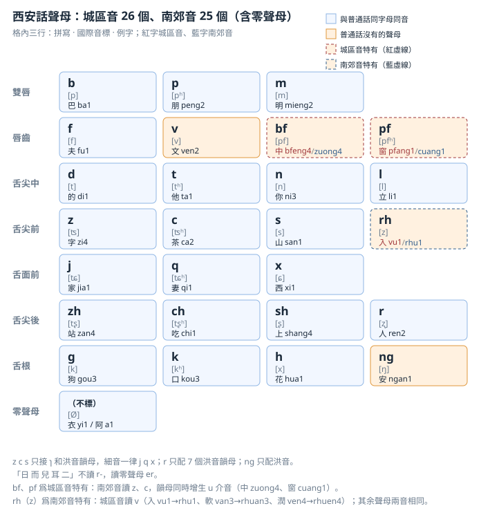
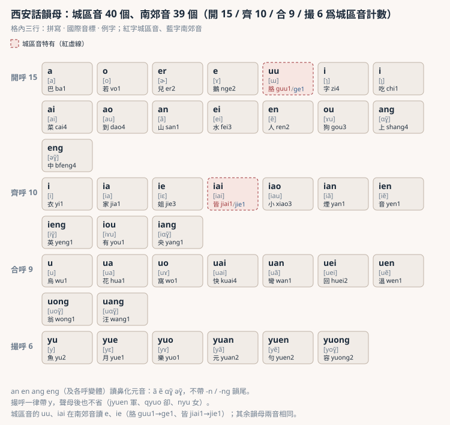
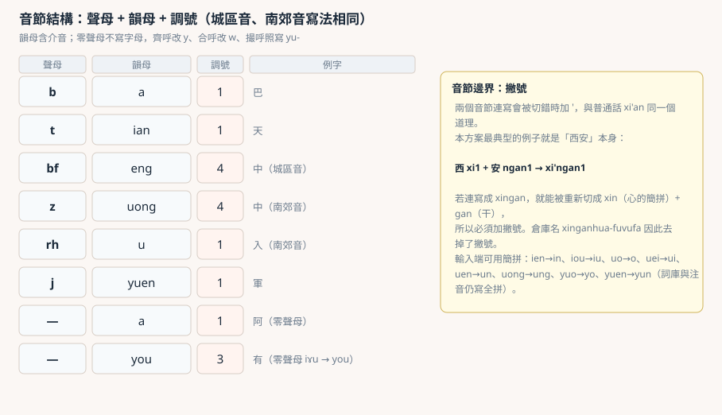
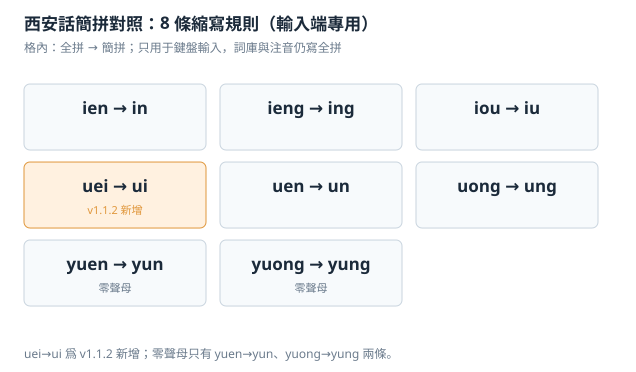
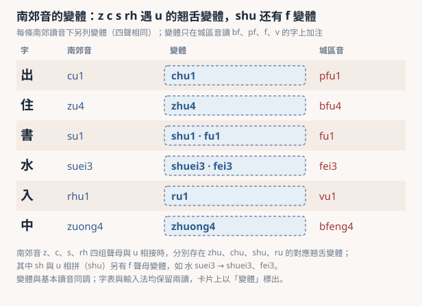

[簡體中文](README.md) ｜ **繁體中文** ｜ [English](README.en.md) ｜ [日本語](README.ja.md)

# 西安話字音查詢 · xinganhua-ziyencaxin

> 輸入漢字（簡繁皆可，一次最多 30 字），查它在西安話裏的兩套讀法——**城區音**與**南郊音**：**西安話拼音**、**國際音標**、**聲調**，以及詞典原有的釋注。界面有簡、繁、英、日四種語言，並按系統語言與接入地區自動判定。

- **線上地址**：<https://siqyin.github.io/xinganhua-ziyencaxin/>
- **字表**：城區字頭 3,345 ／ 城區音 3,648 條 · 南郊音 4,534 條（南郊字頭 4,065，含渭南獨有等新增 720 字）
- **語言**：簡體中文 · 繁體中文 · English · 日本語（自動判定 + 手選）
- **配色**：黑 `#000000`（秦）· 白 `#FFFFFF` · 絳紅 `#9F363A`（漢）
- **字體**：霞鶩文楷子集，自託管，不依賴 CDN

---

## 目錄

1. [西安話拼音方案](#s1)
2. [這個網站是什麼](#s2)
3. [查詢規則](#s3)
4. [結果怎麼讀](#s4)
5. [音系與輸入方案浮窗](#s5)
6. [數據從哪來](#s6)
7. [配色與字體](#s7)
8. [目錄結構](#s8)
9. [本地預覽](#s9)
10. [重新構建](#s10)
11. [部署](#s11)
12. [數據說明與待辦](#s12)
13. [數據與致謝](#s13)
14. [授權](#s14)

---

<a id="s1"></a>

## 一、西安話拼音方案

本站的每一個讀音都用**西安話拼音**標註，城區音、南郊音各一套。一個音節寫成「聲母 + 韻母 + 調號」，例如 `ba1` 巴、`jyuen1` 軍；`bfeng4` 中是城區音，南郊音作 `zuong4`：

- **聲母**：兩套共用 24 個（含零聲母），城區音另有 `bf`、`pf`（共 26），南郊音另有 `rh`（共 25）：`b p m f v bf pf d t n l z c s rh j q x zh ch sh r g k h ng`
- **韻母**：兩套共用 38 個（開 15 ／ 齊 8 ／ 合 9 ／ 撮 6），城區音另有 `uu`、`iai`，共 40 個（開 16 ／ 齊 9 ／ 合 9 ／ 撮 6）
- **四聲**：陰平 21、陽平 24、上聲 53、去聲 44；入聲已併入四調
- **調號緊貼音節**，不空格：`bfeng4` 中、`jyuen1` 軍
- **音節邊界用撇號**：`xi'ngan1` 西安（否則會被切成 xin 心 + gan 幹）
- **簡拼**：輸入端兼容 `in / ing / iu / ui / un / ung / yun / yung`（分別對應 `ien / ieng / iou / uei / uen / uong / yuen / yuong`；零聲母只放行 `yuen`、`yuong`）；調號不輸入。
- **拼音反查**：輸入一個音節（全拼或簡拼，帶不帶調號都行）即可反查讀它的字；界面上有**全拼／簡拼顯示開關**，切到簡拼後卡片上的注音就用簡拼寫法（音標不變）。

下面五張圖把方案講全（與輸入法倉庫 [xinganhua-fuvufa](https://github.com/SiqYin/xinganhua-fuvufa) 用的是同一套圖，各語言版本內容一致）：






西安話的連讀變調主要是前字變調，分爲兩類：連續兩字爲一聲（陰平）21-21 時，第一個一聲字改讀二聲（陽平）24-21；連續兩字爲三聲（上聲）53-53 時，第一個三聲字改讀一聲（陰平）21-53。







**南郊音變體**：南郊音 z、c、s、rh 四組聲母與 u 相接時，分別存在 zhu、chu、shu、ru 的對應翹舌變體；其中 sh 與 u 相拼（shu）另有 f 聲母變體。上述變體只在城區音讀 bf、pf、f、v 的字上加註，例如「水」南郊音 `suei3` 另有變體 `shuei3`、`fei3`；變體與基本讀音同調，字表中另立一行並註明「變體」。


### 城區音與南郊音

西安話內部不止一種口音，本站同時收兩套：

- **城區音**：西安城區（城內）的口音。
- **南郊音**：西安南郊（高新、小寨、曲江一帶）的口音。平翹舌分布屬**渭南型**：聲母 25 個（多 `rh`，沒有 `bf`、`pf`），韻母 38 個（沒有 `uu`、`iai`），聲調仍是四聲。

| 項 | 城區音 | 南郊音 |
|---|---|---|
| 聲母 | 26（含 `bf`、`pf`） | 25（含 `rh`，無 `bf`、`pf`） |
| 韻母 | 40（含 `uu`、`iai`） | 38（無 `uu`、`iai`） |
| rh | 入 `vu1`、若 `vo1` | `rhu1`、`rhuo1` |
| 知系合口 | 豬 `bfu1`、春 `pfen1` | `zu1`、`cuen1` |
| 書母合口 | 書 `fu1`、水 `fei3` | `su1`、`suei3` |
| 遇攝一等 | 都 `du1`、粗 `cu1` | `dou1`、`cou1` |
| 聲調 | 陰平 21、陽平 24、上聲 53、去聲 44 | 同城區音 |

3,345 個字裏，兩套讀法完全相同的 2,971 字，有差異的 374 字；查詢結果裏每個字把兩套讀音並排列出。

方案的完整說明——聲母韻母的分佈規則、正字法細則、與普通話拼音的逐條對照、可用的簡拼——見輸入法倉庫的 [README](https://github.com/SiqYin/xinganhua-fuvufa)（[簡體](https://github.com/SiqYin/xinganhua-fuvufa/blob/main/README.md) ／ [繁體](https://github.com/SiqYin/xinganhua-fuvufa/blob/main/README.zh-Hant.md) ／ [English](https://github.com/SiqYin/xinganhua-fuvufa/blob/main/README.en.md) ／ [日本語](https://github.com/SiqYin/xinganhua-fuvufa/blob/main/README.ja.md)）。

---

<a id="s2"></a>

## 二、這個網站是什麼

一個離線的靜態網頁：沒有後端、沒有數據庫，除頁面自身的 JSON 與字體外不發任何請求，把一個字在西安話裏的**所有**讀音攤開給你看。
頁面下方另有一段「西安市的口音分區」：以明城牆以內的城區爲中心，按方位分東、西、南、北四郊；城區與北郊、西郊屬西安型，南郊、東郊屬渭南型。東北以城牆東緣向北引的直線爲界，西南以城牆西南角向西南引的斜線爲界。示意圖只是方位示意，不是行政邊界。

版面分五層，全是黑白絳紅三色的不同層次：暖紙頁底 → 淺色卡片 → 白色讀音塊 → 絳紅強調（印章、按鈕、調號、釋注）→ 墨黑頁腳。

---

<a id="s3"></a>

## 三、查詢規則

| 規則 | 行爲 |
|---|---|
| 簡繁 | 輸入簡體先折成字典裏的繁體字頭再查（`鵝`→`鵝`、`邊`→`邊`）；輸入繁體直接命中 |
| 字數 | 一次最多 30 個漢字，超出會提示實際字數，不出結果 |
| 去重 | 輸入裏重複的字只查一次；簡繁混輸（如「鵝着軍」）各自展開 |
| 非漢字 | 字母、數字、符號會被過濾；全是非漢字時給出提示（本頁不做拼音反查） |
| 未收錄 | 字表裏沒有的字會顯示一張「未收錄」卡片，不會靜默消失 |
| 分享 | 查詢寫入地址欄 `?q=…`，複製鏈接可復原結果 |

---

<a id="s4"></a>

## 四、結果怎麼讀

每個字一張卡片：左邊是大字與簡體形，右邊並排兩欄——**城區音**與**南郊音**，各自逐條列讀音。兩欄的條數可能不同（南郊音常把一些又讀並掉）。

| 位置 | 內容 | 例 |
|---|---|---|
| 拼音 | 全拼 + 調號（調號用絳紅；城區音紅、南郊音藍） | `bfeng4` ／ `zuong4` |
| 音標 | 國際音標 + 調值上標，與左欄拼音一一對應（城區音紅、南郊音藍） | `[pfəɣ̃⁴⁴]` ／ `[ʦuoɣ̃⁴⁴]` |
| 聲調 | 調名 + 調值（英文界面顯示 Yinping / Yangping / Shangsheng / Qusheng，日文界面顯示 陰平 / 陽平 / 上聲 / 去聲） | 去聲 44 |
| 釋注 | 字表原帶的 `{}` 註釋；`白讀／文讀` 單獨標出 | 釋 白讀, 西~, 北~ |

調號對照：

| 調號 | 1 | 2 | 3 | 4 |
|---|---|---|---|---|
| 調名 | 陰平 | 陽平 | 上聲 | 去聲 |
| 調值 | 21 | 24 | 53 | 44 |
| 例 | `tian1` 天 | `nian2` 年 | `xiao3` 小 | `qu4` 去 |

多音字按陰平 → 陽平 → 上聲 → 去聲排序，例如 `着` 有五讀：`zhao1` / `zhe1` / `bfuo2` / `pfuo2` / `zhao2`。

---

<a id="s5"></a>

## 五、音系與輸入方案浮窗

頁面下方的「西安話音系與輸入方案」是一整塊可點的入口，點開是浮窗（Esc 或點遮罩關閉），內容取自輸入法倉庫的 README：

- 聲母 27 格（共用 24 ＋ 城區特有 `bf`、`pf` ＋ 南郊特有 `rh`，虛線框標出）
- 韻母 40 格，按開齊合撮四呼分組，`uu`、`iai` 標爲城區音特有
- 四聲與調值（兩支相同）
- **城區音與南郊音的區別**：聲韻母數量、`rh`、`bf`／`pf` 與 `uu`／`iai` 的對應，以及其他成組差異
- **與普通話拼音的異同**：聲母完全一樣的、鼻化韻母的讀法、城區音多出來的聲母韻母（南郊音另有 `rh`）、聲母對不上的字、調號同位不同調值
- 浮窗內的文案隨界面語言切換（簡 / 繁 / 英 / 日）

---

<a id="s6"></a>

## 六、數據從哪來

西安話城區音來源於記錄城區音的西安話音檔；南郊音參考西安話、渭南話、臨潼話、華縣話等音檔逐字釐定，如有錯謬，敬請批評指正。

- [西安話音檔](https://github.com/osfans/MCPDict/blob/master/tools/tables/data/%E8%A5%BF%E5%AE%89.tsv)
- [渭南話音檔](https://github.com/osfans/MCPDict/blob/master/tools/tables/data/%E6%B8%AD%E5%8D%97.tsv)
- [臨潼話音檔](https://github.com/osfans/MCPDict/blob/master/tools%2Ftables%2Fdata%2F%E4%B8%B4%E6%BD%BC%E6%96%B9%E8%A8%80%E8%AF%AD%E9%9F%B3%E7%A0%94%E7%A9%B6.tsv)
- [華縣音檔](https://github.com/osfans/MCPDict/blob/master/tools%2Ftables%2Fdata%2F%E5%8D%8E%E5%8E%BF.tsv)

---

<a id="s7"></a>

## 七、配色與字體

| 顏色 | 值 | 用途 |
|---|---|---|
| 黑 | `#000000` | 正文、字頭、頁腳底；秦色 |
| 白 | `#FFFFFF` | 卡片與讀音塊、輸入框；三色之中的「紙」 |
| 絳紅 | `#9F363A` | 印章、按鈕、卡片左邊、頁腳強調、調號、音標上標、釋注邊線；漢色 |

底色還有兩層中性層次（暖紙 `#F4EEE9` 頁底、淺卡 `#FBF7F4`），是黑白之間的過渡，不另立色相。

字體是 [霞鶩文楷](https://github.com/lxgw/LxgwWenKai)（LXGW WenKai Regular，OFL 授權）的子集：`fonts/lxgw-wenkai.woff2`，只含頁面實際用到的字形（字頭、釋注、拼音、音標與四語界面文案，約 4,900 字形 / 1.2 MB）。字體授權見 `fonts/OFL.txt`。

---

<a id="s8"></a>

## 八、目錄結構

```
index.html                    單頁：樣式、查詢邏輯、i18n 與浮窗都在這一個文件裏
README.zh-Hant.md             繁體說明（OpenCC 轉出）
README.en.md / README.ja.md   英文、日文說明
data/source.tsv               字音源表：字 / 拼音 / IPA[調名] / 釋注
data/xian.json                前端數據：字頭 → 城區音讀音數組
data/nanjiao.json             前端數據：字頭 → 南郊音讀音數組
data/variants.json            簡繁映射：s2t（簡→繁）、t2s（繁→簡，用於並列顯示）
data/i18n.json                四語文案 + 音系表數據（簡 / 繁 / 英 / 日）
figures/                      西安話拼音方案配圖：五張圖 × 四種語言（與輸入法倉庫同一套）
fonts/lxgw-wenkai.woff2       霞鶩文楷子集
fonts/OFL.txt                 字體授權
tools/build_data.py           源表 → JSON（OpenCC 表缺失時自動下載）
tools/build_nanjiao_json.py   南郊音字表 → data/nanjiao.json
tools/build_i18n.py           簡體文案 → 繁體（OpenCC）+ 英、日，輸出 i18n.json
tools/i18n.src.json           四語文案的源文件（簡 / 英 / 日，繁體由腳本生成）
tools/make_font.py            字體子集化（WOFF2）
.github/workflows/static.yml  推到 main 時自動發佈 GitHub Pages
```

---

<a id="s9"></a>

## 九、本地預覽

頁面用 `fetch` 讀 JSON，直接雙擊 HTML 會失敗，起個靜態服務器即可：

```sh
python -m http.server 8765
# 打開 http://127.0.0.1:8765/
```

---

<a id="s10"></a>

## 十、重新構建

```sh
python tools/build_data.py          # 生成 data/xian.json、data/variants.json
python tools/build_nanjiao_json.py  # 生成 data/nanjiao.json（南郊音）
python tools/build_i18n.py          # 生成 data/i18n.json（繁體由 OpenCC 轉出）
python tools/make_font.py           # 重新生成字體子集
```

`make_font.py` 默認讀 `D:\Wu\NetDisk Download\lxgw-wenkai-v1.530\lxgw-wenkai-v1.530\LXGWWenKai-Regular.ttf`，也可以用參數或環境變量 `LXGW_TTF` 指定：

```sh
python tools/make_font.py /path/to/LXGWWenKai-Regular.ttf
```

改了 `index.html` 裏的文案、`data/*.json` 或數據後都要重跑 `make_font.py`，否則新字（尤其是日文假名與新字體漢字）會落回系統字體。

---

<a id="s11"></a>

## 十一、部署

推到 `main` 後由 GitHub Actions 發佈（倉庫 Settings → Pages → Source 選 GitHub Actions）。工作流把 `index.html`、`data/xian.json`、`data/nanjiao.json`、`data/variants.json`、`data/i18n.json`、`fonts/*.woff2` 與 OFL 拷進 `_site`，源表與構建腳本不隨站點發布。

---

<a id="s12"></a>

## 十二、數據說明與待辦

- 用字是繁體（MCPDict 原表如此），卡片上並列顯示簡體形，便於對照
- 南郊音按西安南郊音逐字裁定表（2026-11-20）與兩地一致讀音折出，硬約束是「沒有 `bf`／`pf`（城區特有）、沒有 `uu`／`iai`（城區特有）」，另有 `rh`（城區讀 v）；`bf→z`、`pf→c`（韻母增生 u 介音），`uu→e`，`iai→ie`。個別字按覈定覆蓋：癌只讀 `ngai2`、涯讀 `ya2`、後只讀 `hou4`、芍讀 `shuo2`
- 原表有 3 個只有音、沒有字的音節（`zou2`、`tai3`、`sao2`），不進查詢
- 拼音與音標若與你的方言有出入，以 `data/source.tsv` 爲準，改完重跑構建腳本即可
- 待辦：音標反查、按聲調查詢、字表分頁瀏覽（拼音反查與全拼／簡拼顯示已上線）

---

<a id="s13"></a>

## 十三、數據與致謝

- [西安話音檔](https://github.com/osfans/MCPDict/blob/master/tools/tables/data/%E8%A5%BF%E5%AE%89.tsv)、[渭南話音檔](https://github.com/osfans/MCPDict/blob/master/tools/tables/data/%E6%B8%AD%E5%8D%97.tsv)、[臨潼話音檔](https://github.com/osfans/MCPDict/blob/master/tools%2Ftables%2Fdata%2F%E4%B8%B4%E6%BD%BC%E6%96%B9%E8%A8%80%E8%AF%AD%E9%9F%B3%E7%A0%94%E7%A9%B6.tsv)、[華縣話音檔](https://github.com/osfans/MCPDict/blob/master/tools%2Ftables%2Fdata%2F%E5%8D%8E%E5%8E%BF.tsv)——均出自 [osfans/MCPDict](https://github.com/osfans/MCPDict)；西安話音檔即城區音字音數據源（國際音標），渭南、臨潼、華縣三檔用於南郊音的整理參照
- **南郊話音檔**沒有現成字表可依：以西安話、渭南話、臨潼話、華縣話音檔等爲基底，參照知乎上關於南郊音、東郊音平翹舌歸併情況的討論，並與本人及家人的口音逐字校對整理而成，因此**僅供參考**
- [xinganhua-fuvufa](https://github.com/SiqYin/xinganhua-fuvufa) —— 西安話拼音方案、轉寫腳本、音系說明與四語配圖
- [OpenCC](https://github.com/BYVoid/OpenCC) —— 簡繁對照表
- [霞鶩文楷](https://github.com/lxgw/LxgwWenKai) —— 中文字體（OFL）
- [wugniu_zyinzozin](https://github.com/SiqYin/wugniu_zyinzozin) —— 站點做法、語言判定與浮窗版面的參照

---

<a id="s14"></a>

## 十四、授權

網頁與構建腳本可自由使用、修改、再分發。字音數據來自 MCPDict，字體來自霞鶩文楷，版權與授權請遵循各自項目說明。

---

## 聲明

簡體版爲源文；繁體版由 OpenCC 從簡體轉出，英文與日文版爲對應譯本。四版內容一致，如有出入以簡體版爲準。本文由 AI 輔助撰寫與翻譯。
