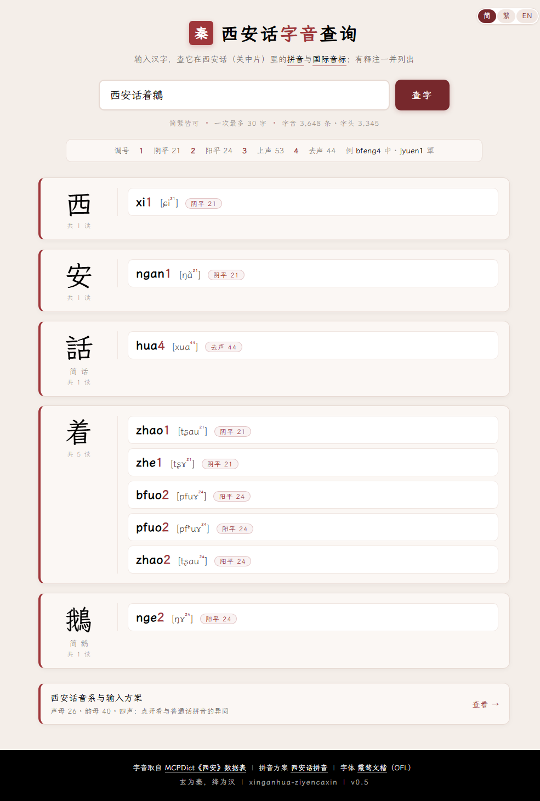
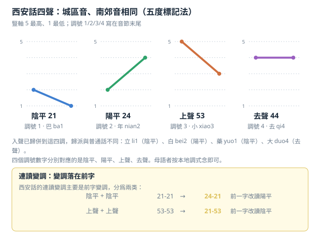

[簡體中文](README.md) ｜ **繁體中文** ｜ [English](README.en.md) ｜ [日本語](README.ja.md)

# 西安話字音查詢 · xinganhua-ziyencaxin

> 輸入漢字（簡繁皆可，一次最多 30 字），查它在西安話（關中片）裏的全部字音：**西安話拼音**、**國際音標**、**聲調**，以及詞典原有的釋注。界面有簡、繁、英、日四種語言，並按系統語言與接入地區自動判定。



- **線上地址**：<https://siqyin.github.io/xinganhua-ziyencaxin/>
- **字表**：字頭 3,345 ／ 字音 3,648 ／ 多音字 275 ／ 帶釋注 102
- **語言**：簡體中文 · 繁體中文 · English · 日本語（自動判定 + 手選）
- **配色**：黑 `#000000`（秦）· 白 `#FFFFFF` · 絳紅 `#9F363A`（漢）
- **字體**：霞鶩文楷子集，自託管，不依賴 CDN

---

## 目錄

1. [西安話拼音方案](#s1)
2. [這個網站是什麼](#s2)
3. [查詢規則](#s3)
4. [結果怎麼讀](#s4)
5. [語言與自動判定](#s5)
6. [音系與輸入方案浮窗](#s6)
7. [數據從哪來](#s7)
8. [配色與字體](#s8)
9. [目錄結構](#s9)
10. [本地預覽](#s10)
11. [重新構建](#s11)
12. [部署](#s12)
13. [數據說明與待辦](#s13)
14. [數據與致謝](#s14)
15. [授權](#s15)

---

<a id="s1"></a>

## 一、西安話拼音方案

本站的每一個讀音都用**西安話拼音**標註。一個音節寫成「聲母 + 韻母 + 調號」，例如 `ba1` 巴、`bfeng4` 中、`jyuen1` 軍：

- **聲母 26 個**（含零聲母）：`b p m f v bf pf d t n l z c s j q x zh ch sh r g k h ng`
- **韻母 40 個**：開 15 ／ 齊 10 ／ 合 9 ／ 撮 6
- **四聲**：陰平 21、陽平 24、上聲 53、去聲 44；入聲已併入四調
- **調號緊貼音節**，不空格：`bfeng4` 中、`jyuen1` 軍
- **音節邊界用撇號**：`xi'ngan1` 西安（否則會被切成 xin 心 + gan 幹）

下面四張圖把方案講全（與輸入法倉庫 [xinganhua-fuvufa](https://github.com/SiqYin/xinganhua-fuvufa) 用的是同一套圖，各語言版本內容一致）：





方案的完整說明——聲母韻母的分佈規則、正字法細則、與普通話拼音的逐條對照、可用的簡拼——見輸入法倉庫的 [README](https://github.com/SiqYin/xinganhua-fuvufa)（[簡體](https://github.com/SiqYin/xinganhua-fuvufa/blob/main/README.md) ／ [繁體](https://github.com/SiqYin/xinganhua-fuvufa/blob/main/README.zh-Hant.md) ／ [English](https://github.com/SiqYin/xinganhua-fuvufa/blob/main/README.en.md) ／ [日本語](https://github.com/SiqYin/xinganhua-fuvufa/blob/main/README.ja.md)）。

---

<a id="s2"></a>

## 二、這個網站是什麼

一個離線的靜態網頁：沒有後端、沒有數據庫，除頁面自身的 JSON 與字體外不發任何請求，把一個字在西安話裏的**所有**讀音攤開給你看。

版面分五層，全是黑白絳紅三色的不同層次：暖紙頁底 → 淺色卡片 → 白色讀音塊 → 絳紅強調（印章、按鈕、調號、釋注）→ 墨黑頁腳。

---

<a id="s3"></a>

## 三、查詢規則

| 規則 | 行爲 |
|---|---|
| 簡繁 | 輸入簡體先折成字典裏的繁體字頭再查（`鵝`→`鵝`、`邊`→`邊`）；輸入繁體直接命中 |
| 字數 | 一次最多 30 個漢字，超出會提示實際字數，不出結果 |
| 去重 | 輸入裏重複的字只查一次；簡繁混輸（如「鵝着軍」）各自展開 |
| 非漢字 | 字母、數字、符號會被過濾；全是非漢字時給出提示（本頁不做拼音反查） |
| 未收錄 | 字表裏沒有的字會顯示一張「未收錄」卡片，不會靜默消失 |
| 分享 | 查詢寫入地址欄 `?q=…`，複製鏈接可復原結果 |

---

<a id="s4"></a>

## 四、結果怎麼讀

每個字一張卡片：左邊是大字與簡體形，右邊逐條列讀音。

| 位置 | 內容 | 例 |
|---|---|---|
| 拼音 | 全拼 + 調號（調號用絳紅） | `bfeng4` |
| 音標 | 國際音標 + 調值上標 | `[pfã⁴⁴]` |
| 聲調 | 調名 + 調值（英文界面顯示 Yinping / Yangping / Shangsheng / Qusheng，日文界面顯示 陰平 / 陽平 / 上聲 / 去聲） | 去聲 44 |
| 釋注 | 字表原帶的 `{}` 註釋；`白讀／文讀` 單獨標出 | 釋 白讀, 西~, 北~ |

調號對照：

| 調號 | 1 | 2 | 3 | 4 |
|---|---|---|---|---|
| 調名 | 陰平 | 陽平 | 上聲 | 去聲 |
| 調值 | 21 | 24 | 53 | 44 |
| 例 | `tian1` 天 | `nian2` 年 | `xiao3` 小 | `qu4` 去 |

多音字按陰平 → 陽平 → 上聲 → 去聲排序，例如 `着` 有五讀：`zhao1` / `zhe1` / `bfuo2` / `pfuo2` / `zhao2`。

---

<a id="s5"></a>

## 五、語言與自動判定

界面右上角可以手選 **簡 / 繁 / 日 / EN**，選擇會記在本地（`localStorage`）。首次訪問時按下面的優先級判定：

| 優先級 | 依據 | 結果 |
|---|---|---|
| 1 | 手動選擇（含網址 `?lang=hans｜hant｜ja｜en`） | 直接使用 |
| 2 | 系統／瀏覽器語言（**只認中文變體與日文**） | `zh-Hant`、`zh-TW/HK/MO` → 繁體；其他 `zh-*` → 簡體；`ja-*` → 日文；非中文、非日文的系統語言（`en-*`、`ko-*` 等）不參與判定，交給下一行 |
| 3 | 訪問 IP 歸屬地 | 日本 → 日文；美國、英國、加拿大、澳大利亞、新西蘭、法國、德國、韓國 → 英文；香港、澳門、臺灣 → 繁體；其餘全部 → 簡體 |
| 4 | 兜底 | 簡體 |

也就是說**中文系統語言與日文系統語言優先於 IP**：系統是繁體中文，即使 IP 在中國大陸也顯示繁體；系統是日文，即使 IP 在美國也顯示日文。除此之外的系統語言（英文、韓文……）不決定界面語言，交給 IP 判斷——所以「英文系統 + 日本 IP」顯示日文，而不是英文。

> 手選與網址 `?lang=` 的優先級最高，且手選會記在 `localStorage`。若之前點過 EN、地址欄還留着 `?lang=en`，頁面就會一直是英文；打開一次 `?lang=auto` 即可清掉手選重新判定。

實現細節：

- 地理判定用 `https://api.country.is/`，失敗時回退 Cloudflare 的 `/cdn-cgi/trace`，都超時（1.5 秒）就按簡體
- 本地預覽（`localhost` / `127.0.0.1` / `file:`）與搜索引擎爬蟲不做自動判定，保持簡體，避免開發時被網絡環境帶着跑、也避免收錄到英文版
- 調試：`?lang=auto` 清掉手選後重新判定；`?lang=debug` 在頁頭顯示判定結果與原因（`url` / `manual` / `system` / `ip` / `offline`）
- 四套文案在 `data/i18n.json`；繁體由 OpenCC 從簡體轉換，不手寫

---

<a id="s6"></a>

## 六、音系與輸入方案浮窗

頁面下方的「西安話音系與輸入方案」是一整塊可點的入口，點開是浮窗（Esc 或點遮罩關閉），內容取自輸入法倉庫的 README：

- 聲母 26 個（寫法 / 國際音標 / 例字）
- 韻母 40 個，按開齊合撮四呼分組
- 四聲與調值
- **與普通話拼音的異同**：完全一樣的、字母相同音值不同的鼻化韻、拼寫差異表（`in→ien`、`ong→uong`、`ü→yu`…）、西安多出來的聲母韻母、聲母對不上的字、調號同位不同調值
- 浮窗內的文案隨界面語言切換（簡 / 繁 / 英 / 日）

---

<a id="s7"></a>

## 七、數據從哪來

```
MCPDict《西安》數據表（國際音標）
        │  tools/ipa2pinyin.mjs（輸入法倉庫）
        ▼
   字 / 拼音 / IPA / 釋注  →  data/source.tsv
        │  tools/build_data.py（+ OpenCC 簡繁表）
        ▼
   data/xian.json（字頭 → 讀音數組）
   data/variants.json（簡→繁、繁→簡）
```

| 項 | 數 |
|---|---|
| 字頭 | 3,345 |
| 字音條目 | 3,648（一字一音一行） |
| 多音字 | 275 |
| 帶釋注 | 102 |
| 不計調音節 | 392 |

簡繁映射用 OpenCC 的 `STCharacters.txt` / `TSCharacters.txt`，構建時按需下載，不隨倉庫分發。

---

<a id="s8"></a>

## 八、配色與字體

| 顏色 | 值 | 用途 |
|---|---|---|
| 黑 | `#000000` | 正文、字頭、頁腳底；秦色 |
| 白 | `#FFFFFF` | 卡片與讀音塊、輸入框；三色之中的「紙」 |
| 絳紅 | `#9F363A` | 印章、按鈕、卡片左邊、頁腳強調、調號、音標上標、釋注邊線；漢色 |

底色還有兩層中性層次（暖紙 `#F4EEE9` 頁底、淺卡 `#FBF7F4`），是黑白之間的過渡，不另立色相。

字體是 [霞鶩文楷](https://github.com/lxgw/LxgwWenKai)（LXGW WenKai Regular，OFL 授權）的子集：`fonts/lxgw-wenkai.woff2`，只含頁面實際用到的字形（字頭、釋注、拼音、音標與四語界面文案，約 4,900 字形 / 1.2 MB）。字體授權見 `fonts/OFL.txt`。

---

<a id="s9"></a>

## 九、目錄結構

```
index.html                    單頁：樣式、查詢邏輯、i18n 與浮窗都在這一個文件裏
screenshot.png                本說明用的界面截圖
README.zh-Hant.md             繁體說明（OpenCC 轉出）
README.en.md / README.ja.md   英文、日文說明
data/source.tsv               字音源表：字 / 拼音 / IPA[調名] / 釋注
data/xian.json                前端數據：字頭 → 讀音數組
data/variants.json            簡繁映射：s2t（簡→繁）、t2s（繁→簡，用於並列顯示）
data/i18n.json                四語文案 + 音系表數據（簡 / 繁 / 英 / 日）
figures/                      西安話拼音方案配圖：四張圖 × 四種語言（與輸入法倉庫同一套）
fonts/lxgw-wenkai.woff2       霞鶩文楷子集
fonts/OFL.txt                 字體授權
tools/build_data.py           源表 → JSON（OpenCC 表缺失時自動下載）
tools/build_i18n.py           簡體文案 → 繁體（OpenCC）+ 英、日，輸出 i18n.json
tools/i18n.src.json           四語文案的源文件（簡 / 英 / 日，繁體由腳本生成）
tools/make_font.py            字體子集化（WOFF2）
.github/workflows/static.yml  推到 main 時自動發佈 GitHub Pages
```

---

<a id="s10"></a>

## 十、本地預覽

頁面用 `fetch` 讀 JSON，直接雙擊 HTML 會失敗，起個靜態服務器即可：

```sh
python -m http.server 8765
# 打開 http://127.0.0.1:8765/
```

---

<a id="s11"></a>

## 十一、重新構建

```sh
python tools/build_data.py          # 生成 data/xian.json、data/variants.json
python tools/build_i18n.py          # 生成 data/i18n.json（繁體由 OpenCC 轉出）
python tools/make_font.py           # 重新生成字體子集
```

`make_font.py` 默認讀 `D:\Wu\NetDisk Download\lxgw-wenkai-v1.530\lxgw-wenkai-v1.530\LXGWWenKai-Regular.ttf`，也可以用參數或環境變量 `LXGW_TTF` 指定：

```sh
python tools/make_font.py /path/to/LXGWWenKai-Regular.ttf
```

改了 `index.html` 裏的文案、`data/*.json` 或數據後都要重跑 `make_font.py`，否則新字（尤其是日文假名與新字體漢字）會落回系統字體。

---

<a id="s12"></a>

## 十二、部署

推到 `main` 後由 GitHub Actions 發佈（倉庫 Settings → Pages → Source 選 GitHub Actions）。工作流把 `index.html`、`data/xian.json`、`data/variants.json`、`data/i18n.json`、`fonts/*.woff2` 與 OFL 拷進 `_site`，源表與構建腳本不隨站點發布。

---

<a id="s13"></a>

## 十三、數據說明與待辦

- 用字是繁體（MCPDict 原表如此），卡片上並列顯示簡體形，便於對照
- 原表有 3 個只有音、沒有字的音節（`zou2`、`tai3`、`sao2`），不進查詢
- 拼音與音標若與你的方言有出入，以 `data/source.tsv` 爲準，改完重跑構建腳本即可
- 待辦：拼音／音標反查、按聲調查詢、字表分頁瀏覽

---

<a id="s14"></a>

## 十四、數據與致謝

- [osfans/MCPDict](https://github.com/osfans/MCPDict)（`tools/tables/data/西安.tsv`）—— 字音數據源
- [xinganhua-fuvufa](https://github.com/SiqYin/xinganhua-fuvufa) —— 西安話拼音方案、轉寫腳本、音系說明與四語配圖
- [OpenCC](https://github.com/BYVoid/OpenCC) —— 簡繁對照表
- [霞鶩文楷](https://github.com/lxgw/LxgwWenKai) —— 中文字體（OFL）
- [wugniu_zyinzozin](https://github.com/SiqYin/wugniu_zyinzozin) —— 站點做法、語言判定與浮窗版面的參照

---

<a id="s15"></a>

## 十五、授權

網頁與構建腳本可自由使用、修改、再分發。字音數據來自 MCPDict，字體來自霞鶩文楷，版權與授權請遵循各自項目說明。

---

## 聲明

簡體版爲源文；繁體版由 OpenCC 從簡體轉出，英文與日文版爲對應譯本。四版內容一致，如有出入以簡體版爲準。本文由 AI 輔助撰寫與翻譯。
